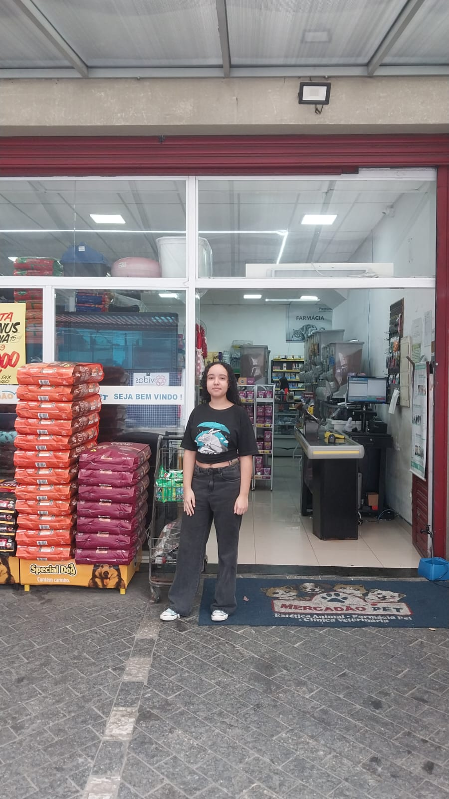
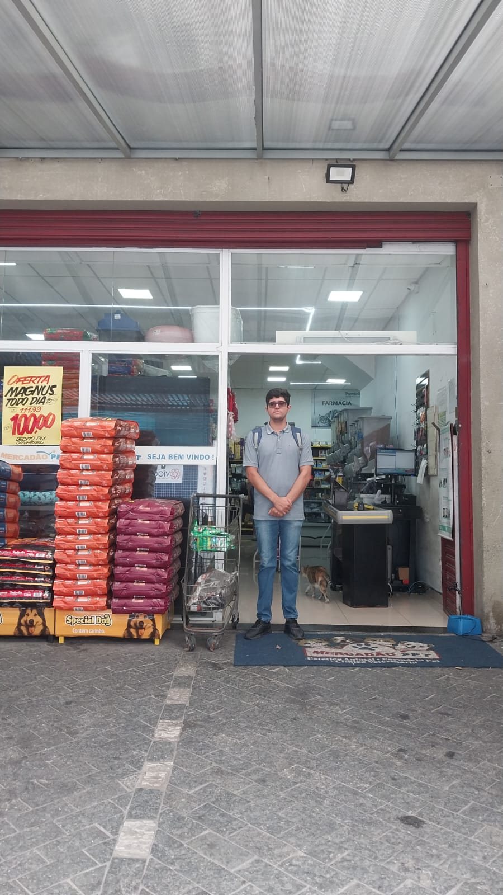
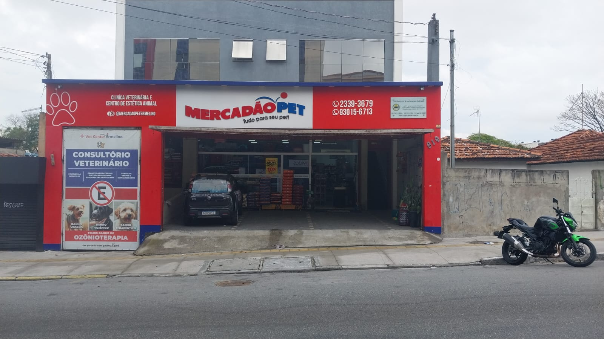
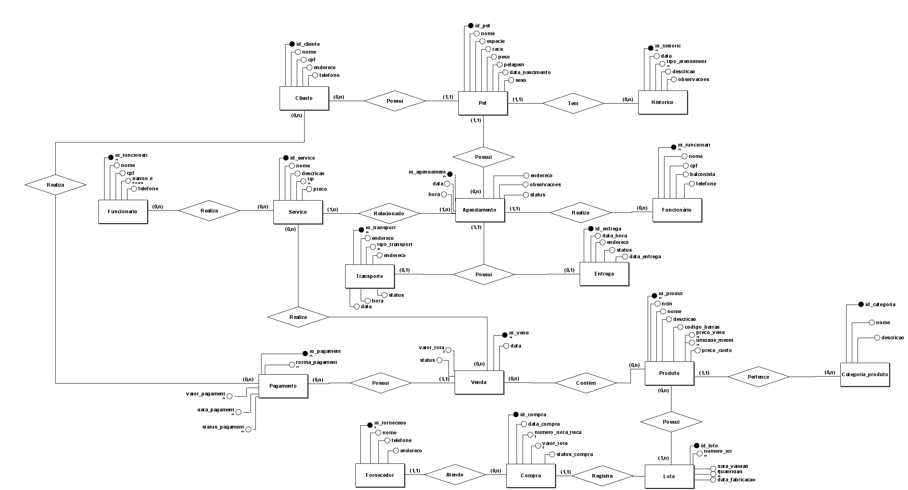
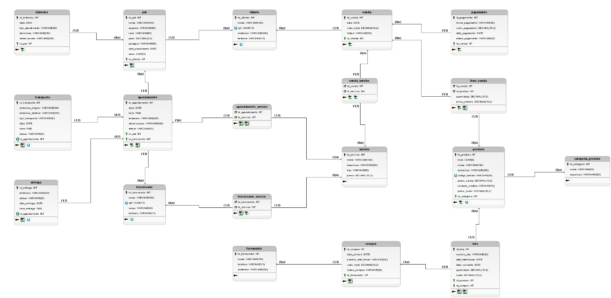

# Modelagem de Banco de Dados para Mercadão Pet

**Entrega 2 — Relatório Técnico Final, Modelo Lógico e Implementação SQL**

## Integrantes

| Integrantes | RGM | Usuário do GitHub |
|---|---|---|
| Alan Carlos Teixeira Marinho de Araujo | 48693871 | Alancarlos1997 |
| Carla Daiane Mamani Choque | 48011762 | carlachoque |
| Giovanna Aparecida dos Santos | 47817518 | giovannasant0s |
| Isabela Barbosa Pereira | 48693821 | isaadsl |
| Isabelly Pereira de França | 48163732 | Isabelly0007 |

## Sumário

- [Introdução](#introdução)
- [1.1 Revisão do Modelo Conceitual](#11-revisão-do-modelo-conceitual) (caracterização, entrevista, processos, requisitos, regras de negócio e DER)
- [1.2 Conversão do Modelo Conceitual para o Modelo Lógico](#12-conversão-do-modelo-conceitual-para-o-modelo-lógico)
- [1.3 Definição de Chaves Primárias e Estrangeiras](#13-definição-de-chaves-primárias-e-estrangeiras)
- [1.4 Processo de Normalização (1FN, 2FN e 3FN)](#14-processo-de-normalização-1fn-2fn-e-3fn)
- [1.5 Justificativas Técnicas das Decisões](#15-justificativas-técnicas-das-decisões)
- [1.6 Proposta de Arquitetura Analítica para BI e IA](#16-proposta-de-arquitetura-analítica-para-bi-e-ia)
- [2. Modelo Lógico Relacional](#2-modelo-lógico-relacional)
- [3. Script SQL Completo](#3-script-sql-completo)
- [4. Massa de Dados](#4-massa-de-dados)
- [5. Repositório GitHub](#5-repositório-github)
- [6. Uso de Inteligência Artificial](#6-uso-de-inteligência-artificial)

## Introdução

O presente projeto tem como objetivo realizar a modelagem conceitual, a conversão para o modelo lógico e a implementação em MySQL de um banco de dados para o Mercadão Pet, organização que atua na venda de produtos para animais, serviços de banho e tosa e atendimento relacionado à clínica veterinária.

A partir de uma pesquisa de campo realizada na organização, foram levantadas informações sobre seus principais processos, incluindo cadastro de clientes e pets, agendamentos, atendimentos, vendas, cadastro de produtos e controle de estoque.

Durante o levantamento, foi identificado como principal problema operacional a utilização de dois sistemas separados para o gerenciamento das vendas e do estoque. Como esses sistemas não são integrados, as informações relacionadas às vendas e à movimentação dos produtos não são atualizadas de forma conjunta, dificultando o acompanhamento da quantidade de itens disponíveis e tornando o controle de estoque menos eficiente.

Dessa forma, o projeto busca propor e implementar uma estrutura de banco de dados capaz de organizar e integrar as principais informações utilizadas pelo estabelecimento. A modelagem cobre os processos relacionados a clientes, pets, funcionários, serviços, atendimentos, produtos, vendas, controle de estoque por lote, fornecedores e compras.

## 1.1 Revisão do Modelo Conceitual

### Caracterização da Organização

**Nome e natureza da organização:**  
O grupo escolheu o Mercadão Pet, um estabelecimento do setor pet que atua com a venda de produtos para animais, serviços de banho e tosa e atendimento relacionado à clínica veterinária.

**Contexto e porte:**  
O Mercadão Pet é uma empresa com fins lucrativos, com diferentes áreas de atuação, envolvendo a comercialização de produtos e a prestação de serviços para animais. Segundo a gerência, o serviço de banho e tosa tem um volume aproximado de **400 atendimentos por semana**, e a organização conta com **20 funcionários** envolvidos em suas atividades. Esses números orientam o tamanho da massa de dados (seção 4) e a capacidade operacional por horário (RN08).

**Problemas e necessidades identificados:**  
Durante a pesquisa de campo, foram identificados quatro problemas de gestão de informações:

- **P1 — Vendas e estoque em sistemas separados:** as vendas e o estoque são controlados em dois sistemas que não se integram. A movimentação dos produtos não é atualizada junto com as vendas, o que dificulta saber a quantidade disponível de cada item e quais lotes estão perto do vencimento.
- **P2 — Cadastro manual de produtos e mercadorias:** o cadastro de produtos e a entrada de mercadorias são feitos manualmente, com registro de preço de custo, NCM e código de barras, sem uma visão organizada de custo, preço de venda e margem.
- **P3 — Pet shop e clínica veterinária sem integração:** os sistemas do pet shop e da clínica veterinária vinculada não compartilham os dados de clientes, animais e atendimentos, o que impede a consulta unificada do histórico de cada pet.
- **P4 — Fornecedores e compras sem registro estruturado:** o contato com fornecedores e o recebimento de mercadorias são feitos por anotações manuais e mensagens, sem cadastro de fornecedores nem rastreio dos pedidos de compra e das notas fiscais.

Diante disso, a principal necessidade é reunir em um único banco de dados as informações de clientes, pets, atendimentos, vendas, estoque por lote, fornecedores e compras.

**Escopo do sistema:**  
O banco de dados reúne os dados da organização como um todo, e não apenas os dos problemas P1 a P4:

- **Loja:** categorias, produtos, lotes, vendas, itens vendidos e pagamentos;
- **Banho e tosa:** clientes, pets, funcionários, serviços, agendamentos, transporte e entrega do pet;
- **Clínica veterinária vinculada:** histórico (prontuário) dos pets e serviços do tipo CLINICA;
- **Compras:** fornecedores, pedidos de compra, notas fiscais e lotes recebidos.

Ficam de fora apenas os processos listados em "Processos prováveis não incluídos", com a justificativa de cada um.

**Justificativa da escolha:**  
O Mercadão Pet foi escolhido por apresentar uma variedade de processos de negócio e um volume significativo de informações relacionadas a clientes, pets, funcionários, serviços, atendimentos, produtos, vendas e estoque.

A diversidade de atividades realizadas pela organização torna o estabelecimento um caso adequado para o desenvolvimento de uma modelagem conceitual abrangente, permitindo representar diferentes processos e seus relacionamentos em uma estrutura integrada de banco de dados.

**Evidências da organização:**  

A existência da organização e o acesso para a realização da pesquisa de campo podem ser comprovados por meio das informações abaixo:

- **Organização no Google:** Mercadão Pet Ermelino Matarazzo — [perfil no Google Maps](https://maps.app.goo.gl/yea361WY7wQY4v9aA)
- **Endereço:** bairro de Ermelino Matarazzo, São Paulo (SP). O endereço completo consta no perfil do Google Maps acima.
- **Contato da loja:** telefone (11) 2339-3679 e WhatsApp (11) 93015-6713, ambos visíveis na fachada (foto 1). Instagram: @mercadaopetermelino (também na fachada).
- **Responsável pela organização:** Guilherme (Gerente), que atendeu o grupo na visita.
- **Legenda das fotos** (arquivos JPG neste repositório): [foto 1](./mercadao-pet-1.jpeg) é a fachada da loja; [foto 2](./mercadao-pet-2.jpeg) e [foto 3](./mercadao-pet-3.jpeg) foram tiradas na entrada da loja durante a visita; [foto 4](./mercadao-pet-4.jpeg) foi tirada no interior da loja, no balcão, durante a visita.
- **Imagens:** 

  
  
  
  

### Relato da entrevista

- **Quem:** o entrevistado foi Guilherme, gerente do Mercadão Pet. Participaram da entrevista os integrantes Alan Carlos Teixeira Marinho de Araújo e Isabelly Pereira de França.

- **Quando e onde:** 14/08/2026, no próprio Mercadão Pet (Ermelino Matarazzo, São Paulo), ou seja, no ambiente da organização.

- **Comprovação:** a visita está comprovada pelas fotos tiradas no local e disponíveis neste repositório em formato JPG, em especial a [foto 4](./mercadao-pet-4.jpeg) (interior da loja, no balcão) e as fotos [2](./mercadao-pet-2.jpeg) e [3](./mercadao-pet-3.jpeg) (entrada da loja).

- **Resumo do levantamento:** Durante a pesquisa de campo, foram levantadas informações sobre as principais atividades do estabelecimento, incluindo venda de produtos, serviços de banho e tosa e atendimento em clínica veterinária vinculada. A organização realiza aproximadamente 400 atendimentos de banho e tosa por semana, mantém cadastros de clientes e pets e utiliza o Sistema Moura para o controle de estoque.

  Também foi identificada a utilização de sistemas separados para o gerenciamento das atividades do pet shop e da clínica veterinária, sem integração entre eles. Essa limitação dificulta o compartilhamento de informações de clientes, animais e atendimentos. Além disso, a gestão de fornecedores ocorre de maneira informal, por meio de anotações manuais e mensagens, sem um cadastro estruturado no sistema.

  O levantamento identificou ainda que o cadastro de produtos e a entrada de mercadorias são realizados manualmente, com registro de informações como preço de custo, NCM e código de barras. Os agendamentos de banho e tosa incluem o horário, os dados do pet, o endereço quando há necessidade de transporte e a identificação do funcionário responsável. O estabelecimento também mantém um histórico dos serviços prestados aos animais e comercializa produtos a granel.

- **Observação presencial:** Durante a visita técnica, observamos que o contato com fornecedores e o recebimento de mercadorias ocorrem de maneira informal, utilizando anotações manuais e mensagens, sem uma rotina estruturada de registro e rastreamento das compras. Também identificamos a falta de integração entre o sistema do pet shop e o da clínica veterinária, o que dificulta a centralização das informações e a consulta unificada dos históricos de atendimento.

- **O que mudou em relação à Entrega 1:**
  - a organização foi mantida: é a mesma organização real da Entrega 1;
  - o porte foi dimensionado (cerca de 400 atendimentos de banho e tosa por semana e 20 funcionários), o que fundamenta o volume da massa de dados;
  - os problemas foram refinados: a ausência de cadastro estruturado de fornecedores (P4) e a falta de integração entre o pet shop e a clínica veterinária (P3) passaram a ser tratadas no modelo;
  - o escopo dos processos e das regras foi ajustado: feiras de adoção e lar temporário não fazem parte da organização e foram removidos; a venda de produtos a granel e a associação do profissional responsável ao atendimento viraram regras de negócio (RF04 e RN06).

- **Arquivo completo:** O levantamento detalhado está organizado no arquivo [`levantamento/levantamento.md`](levantamento/levantamento.md), que reúne as informações obtidas na entrevista, as observações presenciais e os ajustes realizados em relação à Entrega 1.

---

### Processos de Negócio

Os processos abaixo descrevem a operação do Mercadão Pet, com os dados que cada etapa usa. Os nomes entre crases são as colunas do modelo lógico. Quando uma etapa é uma melhoria proposta, e não uma rotina de hoje, isso está indicado.

#### PN01. Atendimento e agendamento de serviços

* Entrada: o cliente entra em contato ou chega ao estabelecimento com o pet.
* Responsáveis: o balconista, no cadastro e no agendamento. O profissional que executa o serviço (banho e tosa ou clínica), no atendimento.
* Etapas:
   1. procurar o cliente pelo `cpf`;
   2. se o cliente não existir, registrar `nome`, `cpf`, `endereco` e `telefone`. Se o pet não existir, registrar `nome`, `especie`, `raca`, `peso`, `pelagem`, `data_nascimento`, `sexo` e o cliente tutor (`id_cliente`);
   3. escolher o serviço (banho, tosa ou consulta) e conferir se há horário disponível (RN08);
   4. criar o agendamento com `data`, `hora`, o pet (`id_pet`), o funcionário responsável (`id_funcionario`) e `status` = AGENDADO. Cada serviço escolhido vira uma linha em AGENDAMENTO_SERVICO (ex.: Banho + Tosa). Se houver transporte, o endereço vai em `endereco`, e o que o cliente pedir fica em `observacoes`;
   5. no dia marcado, o profissional atende o pet e o `status` passa para CONCLUIDO;
   6. registrar o atendimento no histórico do pet, com `data`, `tipo_atendimento`, `descricao` e `observacoes`. Hoje o sistema do pet shop não é integrado ao da clínica; o histórico único dos dois é uma melhoria proposta (P4);
   7. enviar o valor para o caixa, onde ele vira uma venda (PN02).
* Saída: CLIENTE, PET, AGENDAMENTO, AGENDAMENTO_SERVICO e HISTORICO.
* Integração: alimenta o PN02 (venda do serviço), o PN05 (transporte) e o PN06 (cancelamento). A FUNCIONARIO_SERVICO guarda quais serviços cada funcionário executa.

#### PN02. Venda de produtos e serviços no balcão

* Entrada: o cliente vai ao caixa com produtos ou para pagar um serviço já feito.
* Responsáveis: o balconista.
* Etapas:
   1. passar o `codigo_barras` dos produtos ou puxar o serviço já agendado;
   2. buscar o preço de cada produto (`preco_venda`) e de cada serviço (`preco`);
   3. registrar a venda com `data`, o cliente (`id_cliente`) e `valor_total`. Cada produto vira uma linha em ITEM_VENDA, com `quantidade` (inclusive fracionada, nos itens a granel) e o `preco_unitario` praticado. Cada serviço vira uma linha em VENDA_SERVICO;
   4. escolher o lote de onde o produto sai: o de menor `data_validade`, dentro do prazo e com `quantidade` suficiente (RN01, RN05 e RN09; melhoria proposta, a confirmar se a loja já faz isso hoje);
   5. registrar um ou mais pagamentos, com `forma_pagamento` (dinheiro, cartão ou PIX), `valor_pagamento`, `data_pagamento` e `status_pagamento`;
   6. quando os pagamentos confirmados somam o `valor_total` (RN13), o `status` da venda passa para FINALIZADA;
   7. dar baixa na `quantidade` do lote utilizado.
* Saída: VENDA, ITEM_VENDA, VENDA_SERVICO e PAGAMENTO, e o saldo atualizado do LOTE.
* Integração: usa o PN01 (serviços agendados) e o PN03 (lotes disponíveis). Alimenta o PN07 (fechamento de caixa).

#### PN03. Controle de estoque e recebimento de mercadorias

* Entrada: chega uma entrega de mercadorias enviada pelo fornecedor.
* Responsáveis: o funcionário que recebe a mercadoria [confirmar o cargo].
* Etapas:
   1. conferir os itens recebidos com a nota fiscal;
   2. procurar o produto no cadastro, conferindo `codigo_barras` e `ncm`;
   3. se o produto for novo, cadastrar `ncm`, `nome`, `codigo_barras`, `preco_custo`, `preco_venda`, `unidade_medida` e a categoria (`id_categoria`). Se já existir, só selecioná-lo;
   4. registrar um novo lote para o produto, vinculado à compra (`id_compra`), com `numero_lote`, `quantidade`, `custo`, `data_fabricacao` e `data_validade`;
   5. o estoque do produto passa a ser a soma da `quantidade` dos lotes dentro da validade.
* Saída: PRODUTO e LOTE.
* Integração: recebe a compra do PN04 e fornece os lotes para o PN02. Hoje a entrada de mercadorias é feita de forma manual no Sistema Moura; o registro por lote, com validade, é uma melhoria proposta (P1).

#### PN04. Pedido de compra

* Entrada: o funcionário identifica a necessidade de reposição de um produto.
* Responsáveis: o funcionário responsável pelas compras [confirmar o cargo].
* Etapas:
   1. escolher o fornecedor cadastrado (`nome`, `telefone` e `endereco`);
   2. registrar a compra com `data_compra`, `valor_total`, o fornecedor (`id_fornecedor`) e `status_compra` = SOLICITADA. Os produtos não são registrados no pedido: eles entram como lotes, quando a mercadoria chega (PN03);
   3. quando a mercadoria chega, conferir os itens com a nota fiscal, registrar o `numero_nota_fiscal` (RN14) e mudar o `status_compra` para RECEBIDA;
   4. se o pedido não for atendido, o `status_compra` passa para CANCELADA.
* Saída: COMPRA e FORNECEDOR.
* Integração: dispara o PN03 (recebimento e lotes). Hoje o contato com fornecedores e o recebimento são informais, por anotações e mensagens; registrar a compra no sistema é uma melhoria proposta (P3).

#### PN05. Transporte petshop

* Entrada: o cliente precisa que o pet seja buscado e devolvido, ao marcar o agendamento.
* Responsáveis: o balconista, no registro, e o funcionário que faz o transporte [confirmar o cargo].
* Etapas:
   1. ao criar o agendamento (PN01), verificar se o cliente precisa de transporte;
   2. se precisar, registrar a busca como TRANSPORTE vinculado ao agendamento, com `endereco_origem`, `endereco_destino`, `tipo_transporte`, `data`, `hora` e `status` = PENDENTE;
   3. registrar a devolução como ENTREGA vinculada ao mesmo agendamento, com `endereco`, `data_entrega`, `hora_entrega` e `status` = PENDENTE;
   4. cada agendamento tem no máximo um transporte e uma entrega. Quando a busca ou a devolução é feita, o `status` correspondente passa para REALIZADO.
* Saída: TRANSPORTE e ENTREGA.
* Integração: depende do agendamento (PN01) e é cancelado junto com ele (PN06).

#### PN06. Cancelamento de agendamento

* Entrada: o cliente solicita o cancelamento de um agendamento.
* Responsáveis: o balconista.
* Etapas:
   1. localizar o agendamento;
   2. registrar o motivo informado pelo cliente em `observacoes`;
   3. mudar o `status` do agendamento para CANCELADO (RN12), o que libera o horário. O registro não é apagado;
   4. se houver transporte ou entrega pendentes vinculados, o `status` deles também passa para CANCELADO.
* Saída: AGENDAMENTO, TRANSPORTE e ENTREGA atualizados.
* Integração: usa o PN01 e o PN05. Quando o cliente simplesmente não comparece, o caso é registrado como cancelamento.

#### PN07. Fechamento de caixa

* Entrada: o fim do expediente.
* Responsáveis: o responsável pelo caixa [confirmar o cargo].
* Etapas:
   1. consultar os pagamentos confirmados do dia (`data_pagamento` e `status_pagamento`), separados por `forma_pagamento`;
   2. conferir o faturamento e o ticket médio das vendas com `status` = FINALIZADA no dia;
   3. verificar se alguma venda finalizada tem a soma dos pagamentos confirmados diferente do `valor_total`, e corrigir a divergência (RN13).
* Saída: o resumo do dia por forma de pagamento. Não cria registros novos, só consulta VENDA e PAGAMENTO.
* Integração: usa as vendas e os pagamentos do PN02.

#### Processos prováveis não incluídos

- **Consumo de insumos nos serviços:** os materiais usados no banho, na tosa e na clínica (shampoo, medicamentos etc.) não são registrados por atendimento nesta versão do modelo. Eles são controlados como produtos em estoque, por lote, como as demais mercadorias.
- **Doações para ONG:** a loja apenas arrecada doações e as repassa a uma ONG parceira, sem controle no sistema da loja.
- **Feiras de adoção e lar temporário:** a organização não realiza essas atividades, conforme confirmado na entrevista.

---

### Requisitos Funcionais (RF)

- **RF01 (Gestão de Clientes e Pets):**
O sistema deve permitir cadastrar, atualizar e consultar clientes com nome, CPF (11 dígitos numéricos, único), endereço e telefone. Para cada cliente, deve permitir cadastrar um ou mais pets com nome, espécie, raça, peso, pelagem, data de nascimento e sexo (M ou F). Todos esses dados são obrigatórios, e todo pet fica vinculado a exatamente um cliente (tutor).

- **RF02 (Histórico e Prontuário):**
O sistema deve permitir registrar no histórico do pet cada atendimento realizado, com data, tipo de atendimento, descrição e observações (opcional), e consultar o histórico completo de um pet.

- **RF03 (Agendamento de Serviços):**
O sistema deve permitir agendar atendimentos com data, hora, pet, funcionário responsável e um ou mais serviços do catálogo (ex.: Banho + Tosa). O agendamento pode ter endereço (quando há transporte) e observações. Ele começa com o status AGENDADO e pode passar para CONCLUIDO ou CANCELADO.

- **RF04 (Gestão de Vendas no Balcão):**
O sistema deve permitir registrar uma venda com data, cliente, valor total e status (ABERTA, FINALIZADA ou CANCELADA; padrão ABERTA). Para cada produto vendido, registra a quantidade (aceita valores fracionados, para produtos a granel) e o preço unitário praticado. A mesma venda pode incluir os serviços prestados, unificando produtos e serviços no caixa.

- **RF05 (Baixa de Estoque por Lote - Solução do Problema Identificado):**
O sistema deve permitir dar baixa na quantidade do lote a cada produto vendido, retirando primeiro do lote dentro da validade com a menor data de validade e só quando houver saldo suficiente.

- **RF06 (Gestão de Catálogo e Produtos):**
O sistema deve permitir cadastrar e atualizar categorias de produto (nome e descrição) e produtos com NCM (8 dígitos), nome, descrição, código de barras (único), preço de custo, preço de venda, unidade de medida e categoria. Também deve permitir reajustar o preço de venda dos produtos de uma categoria.

- **RF07 (Gestão de Lotes e Validades):**
O sistema deve permitir cadastrar e consultar lotes com número do lote, data de fabricação, data de validade (igual ou posterior à de fabricação), quantidade disponível, custo, produto e compra de origem. Deve permitir consultar os lotes que vencem nos próximos dias e os lotes vencidos que ainda têm saldo.

- **RF08 (Cadastro de Fornecedores):**
O sistema deve permitir cadastrar e consultar fornecedores com nome, telefone e endereço. Os produtos fornecidos por cada fornecedor são identificados pelas compras e pelos lotes recebidos dele.

- **RF09 (Pedidos de Compra):**
O sistema deve permitir registrar pedidos de compra vinculados a um fornecedor, com data da compra, valor total e status (SOLICITADA, RECEBIDA ou CANCELADA; padrão SOLICITADA), e consultar os pedidos ainda não recebidos e há quantos dias estão em aberto.

- **RF10 (Recebimento e Conferência de Mercadorias):**
O sistema deve permitir registrar o recebimento de uma compra, alterando seu status para RECEBIDA, informando o número da nota fiscal e registrando os lotes recebidos vinculados a essa compra.

- **RF11 (Pagamentos e Formas de Pagamento):**
O sistema deve permitir registrar um ou mais pagamentos por venda, cada um com forma de pagamento (DINHEIRO, CARTAO ou PIX), valor (maior que zero), data e status (PENDENTE, CONFIRMADO ou ESTORNADO; padrão PENDENTE), e atualizar o status do pagamento quando ele for confirmado.

- **RF12 (Cancelamento de Agendamentos):**
O sistema deve permitir cancelar um agendamento alterando seu status para CANCELADO, sem excluir o registro, e registrar o motivo no campo de observações. Ao cancelar, o transporte e a entrega pendentes vinculados ao agendamento também passam para CANCELADO.

- **RF13 (Transporte de Pets):**
O sistema deve permitir registrar no máximo um transporte por agendamento, com endereço de origem, endereço de destino, tipo (BUSCA ou DEVOLUCAO), data, hora e status (PENDENTE, REALIZADO ou CANCELADO; padrão PENDENTE).

- **RF14 (Fechamento de Caixa):**
O sistema deve permitir consultar, por dia, o valor recebido em cada forma de pagamento, o faturamento e o ticket médio das vendas finalizadas, e identificar vendas finalizadas cujo total de pagamentos confirmados difere do valor da venda.

- **RF15 (Controle FEFO):**
O sistema deve permitir consultar os lotes disponíveis de um produto (com saldo e dentro da validade) ordenados pela menor data de validade, junto da compra, do fornecedor e da nota fiscal de origem, para indicar de qual lote a saída deve ser feita.

- **RF16 (Catálogo de Serviços):**
O sistema deve permitir cadastrar e consultar serviços com nome, descrição, tipo (BANHO, TOSA, ESTETICA ou CLINICA) e preço (maior ou igual a zero).

- **RF17 (Gestão de Funcionários):**
O sistema deve permitir cadastrar funcionários com nome, CPF (11 dígitos numéricos, único), cargo e telefone, e registrar quais serviços do catálogo cada funcionário executa.

- **RF18 (Entrega - Devolução do Pet):**
O sistema deve permitir registrar no máximo uma entrega (devolução do pet ao cliente) por agendamento, com endereço, data, hora e status (PENDENTE, REALIZADO ou CANCELADO; padrão PENDENTE).

---

### Requisitos Não Funcionais (RNF)

- **RNF01 (Integridade de Dados/Estoque por Lote):**
O banco de dados deve impedir, por meio de restrições de integridade, que o saldo de um lote fique negativo (`quantidade` maior ou igual a zero) ou que um lote tenha data de validade anterior à de fabricação. Toda venda, pagamento, lote e compra deve referenciar registros existentes (chaves estrangeiras com `ON DELETE RESTRICT`), evitando divergências entre vendas e estoque.

- **RNF02 (Segurança e Privacidade/LGPD):**
O sistema deve restringir o acesso ao histórico clínico dos pets e aos dados cadastrais dos clientes (CPF, endereço e telefone) apenas a usuários autenticados e autorizados, com permissões definidas por perfil de acesso. Os perfis operacionais (balcão, banho e tosa, clínica) podem apenas registrar e consultar o histórico, sem permissão para alterá-lo ou apagá-lo, o que garante a RN07.

- **RNF03 (Disponibilidade):**
O módulo comercial (Caixa) e o módulo de agendamentos devem manter disponibilidade de operação durante todo o horário comercial do estabelecimento.

- **RNF04 (Usabilidade):** 
A interface do caixa e de agendamento deve ser simples e intuitiva para permitir finalizações rápidas de atendimentos no balcão.

#### Cobertura dos problemas e dos processos pelos requisitos

| Problema ou processo | Requisitos que o atendem |
|---|---|
| P1 — Vendas e estoque em sistemas separados | RF04, RF05, RF07, RF15 (e RN01, RN05, RN09) |
| P2 — Cadastro manual de produtos e mercadorias | RF06, RF07, RF10 |
| P3 — Pet shop e clínica sem integração | RF01, RF02, RF03, RF16, RF17 |
| P4 — Fornecedores e compras sem registro estruturado | RF08, RF09, RF10 (e RN14) |
| Processo 1 — Atendimento e agendamento de serviços | RF01, RF02, RF03, RF16, RF17 |
| Processo 2 — Venda de produtos e serviços no balcão | RF04, RF05, RF11 |
| Processo 3 — Controle de estoque e compras | RF06, RF07, RF10, RF15 |
| Processo 4 — Pedido de compra | RF08, RF09, RF10 |
| Processo 5 — Transporte petshop | RF13, RF18 |
| Processo 6 — Cancelamento de agendamento | RF12 |
| Processo 7 — Fechamento de caixa | RF11, RF14 |

#### Requisitos prováveis não incluídos

- **Baixa automática do estoque no momento da venda (em tempo real):** o script não tem gatilho (`TRIGGER`) nem procedimento armazenado. A baixa é registrada por `UPDATE` no lote de menor validade (RF05, RN09), e o banco garante apenas que o saldo do lote nunca fique negativo (RNF01). A automação depende do sistema de caixa, que está fora do escopo desta entrega, focada no banco de dados.
- **Consumo de insumos por atendimento (shampoo, medicamentos etc.):** não é registrado por atendimento nesta versão. Os materiais são controlados como produtos em estoque, por lote.
- **Exigência de receita para medicamentos (RN10) e cadastro do veterinário pelo CRMV (RN11):** o cadastro de produtos não identifica quais medicamentos exigem receita, e o atendimento clínico é feito pela clínica veterinária vinculada, de modo que o banco registra o atendimento no histórico do pet, mas não o cadastro profissional do veterinário.
- **Comissão por atendimento:** sugerida durante o uso de IA e rejeitada, porque não faz parte do escopo atual. O grupo manteve o foco na auditabilidade dos agendamentos (RN06).
- **Doações para ONG, feiras de adoção e lar temporário:** a loja apenas arrecada doações e as repassa a uma ONG parceira, sem controle no sistema, e não realiza feiras de adoção nem lar temporário (confirmado na entrevista).
- **Endereço dividido em logradouro, número, bairro e CEP:** o endereço é guardado em uma única coluna, porque nenhum processo ou consulta filtra por região (ver 1FN na seção 1.4).

---

### Regras de Negócio (RN)

- **RN01 (Venda/Lote):**
A saída de um produto só pode ser feita de um lote com saldo suficiente em `quantidade`, que nunca pode ficar negativa.

- **RN02 (Obrigatoriedade do Tutor):** 
Todo Pet cadastrado no sistema deve possuir obrigatoriamente exatamente um Cliente associado `(1,1)`.

- **RN03 (Padrão Fiscal do Cadastro):**
Todo produto cadastrado deve conter obrigatoriamente um código NCM válido de 8 dígitos e preço de venda cadastrado

- **RN04 (Rastreabilidade por Lote):**
Todo lote registrado deve estar atrelado obrigatoriamente a exatamente um único produto cadastrado `(1,1)`. Um mesmo produto, contudo, pode possuir zero ou múltiplos lotes associados `(0,n)`.

- **RN05 (Controle de Validade):**
Não é permitida a venda ou saída no caixa de produtos pertencentes a um lote com data de validade vencida.

- **RN06 (Responsabilidade nos Agendamentos):**
Todo agendamento deve registrar obrigatoriamente o funcionário responsável pelo atendimento `(1,1)`, para fins de auditabilidade e de controle da capacidade por horário (RN08).

- **RN07 (Histórico Inviolável):**
O histórico clínico de um pet não pode ser alterado ou apagado após o registro do atendimento, garantindo a rastreabilidade veterinária. A regra é garantida pela permissão de acesso (RNF02): os usuários operacionais podem apenas inserir e consultar registros na tabela `historico`. Correções são feitas com um novo registro, mantendo o original.

- **RN08 (Capacidade Operacional de Banho e Tosa):**
A quantidade de agendamentos para um mesmo horário não pode ultrapassar o número de funcionários operacionais disponíveis no expediente.

- **RN09 (FEFO):**
Na venda ou no consumo de um produto, deve ser utilizado primeiro o lote com a menor data de validade que ainda esteja dentro do prazo e com saldo disponível (First Expired, First Out).

- **RN12 (Cancelamento de Agendamentos):**
O cancelamento de um agendamento deve registrar o motivo no campo de observações e mudar o status para CANCELADO, sem excluir o registro. O transporte e a entrega pendentes vinculados também passam para CANCELADO. Um agendamento cancelado libera o horário.

- **RN13 (Formas de Pagamento):**
Todo pagamento deve conter forma de pagamento (dinheiro, cartão ou PIX), valor, data e status. Uma venda só pode ser finalizada quando o total dos pagamentos confirmados for igual ao valor da venda.

- **RN14 (Conferência de Nota Fiscal):**
Toda compra recebida deve ter o número da nota fiscal registrado e os itens conferidos antes de seus lotes ficarem disponíveis para venda.

#### Regras prováveis não incluídas

Os códigos abaixo foram mantidos para não alterar a numeração das demais regras.

- **RN10 (Medicamentos com Receita):** a venda de medicamento que exige receita só deveria ser finalizada com a apresentação da receita. Não foi implementada nesta versão: o cadastro de produtos não identifica quais medicamentos exigem receita.
- **RN11 (Identificação do Veterinário):** o veterinário responsável por um atendimento clínico deveria ser identificado pelo CRMV. Não foi implementada nesta versão: o atendimento clínico é feito pela clínica veterinária vinculada, e o banco registra o atendimento no histórico do pet, mas não o cadastro profissional do veterinário.

### Modelagem Conceitual (DER) e Justificativa Técnica

O DER foi criado no **brModelo**, na notação conceitual da disciplina: entidades em retângulos, relacionamentos em losangos, cardinalidades mínima e máxima nos dois lados, identificadores em círculos preenchidos e atributos comuns em círculos vazios. O DER não tem chaves estrangeiras, que aparecem somente no modelo lógico (seção 2).

#### Entidades Reconhecidas
No Diagrama Entidade-Relacionamento (DER) ajustado para o Mercadão Pet, foram modeladas 16 entidades principais.

- **Cliente:** Tutor responsável pelo cadastro e pelos pets.
- **Pet:** Animal de estimação atendido na clínica ou no banho e tosa.
- **Historico:** Prontuário de atendimentos e histórico clínico do pet.
- **Agendamento:** Registro de horário e data para prestação de serviços.
- **Balconista:** Funcionário responsável pela recepção e marcação de agendamentos.
- **Funcionario:** Colaborador responsável pela execução dos serviços, identificado pelo atributo cargo Banho e Tosa.
- **Servico:** Catálogo de serviços oferecidos pelo estabelecimento (ex: Banho, Tosa, Consulta).
- **Venda:** Registro comercial e financeiro da transação no caixa.
- **Produto:** Cadastro dos itens comercializados na loja ou utilizados nos serviços.
- **Categoria_Produto:** Classificação catalográfica dos produtos da loja.
- **Lote:** Controle de estoque por remessas, contendo número do lote, data de fabricação, data de validade, custo e quantidade disponível.
- **Fornecedor:** Cadastro dos distribuidores e parceiros comerciais.
- **Pagamento:** Registro dos pagamentos realizados nas vendas, incluindo forma de pagamento, valor, data e status.
- **Compra:** Registro das aquisições de mercadorias realizadas junto aos fornecedores.
- **Transporte:** Registro do serviço de busca e devolução dos animais para atendimentos de banho e tosa.
- **Entrega:** Registro da devolução do pet ao endereço do cliente após o atendimento, vinculada ao agendamento.

---

#### Justificativa Técnica das Cardinalidades e Decisões de Modelagem

A definição de cardinalidades no modelo conceitual reflete diretamente as regras de negócio capturadas durante a pesquisa de campo no Mercadão Pet, garantindo a integridade dos dados e resolvendo os gargalos operacionais identificados.

##### Decisões Estratégicas para Resolução dos Problemas Identificados

* **Relacionamento entre Venda e Produto:** Foi mantido o relacionamento CONTÉM entre VENDA e PRODUTO, sem a inclusão da entidade `ITEM_VENDA`, conforme orientação do professor. A cardinalidade foi ajustada para `(0,n)`, permitindo vendas que contenham apenas serviços, sem a obrigatoriedade de produtos.

* **Gestão de Validade e Rastreabilidade por Lote:** O controle de estoque permanece centralizado em LOTE, com a inclusão dos atributos número do lote, data de fabricação e data de validade. O atributo `quantidade_estoque` foi removido de PRODUTO para evitar duplicidade de informações.

* **Integração dos Serviços ao Caixa:** Os agendamentos de banho e tosa relacionam-se com a entidade `Servico` `(1,n) Relacionado (1,n)`, permitindo que atendimentos prestados gerem seus respectivos lançamentos em `Venda`, unificando o faturamento do balcão.

* **Rastreabilidade e Atendimento Médico:** A entidade `Pet` mantém cardinalidade `(1,1) Tem (0,n)` com a entidade `Historico`, garantindo que todas as consultas e observações fiquem atreladas a um único animal ao longo do tempo.

* **Fornecedores e Compras:** Foi adicionada a entidade COMPRA, relacionada a FORNECEDOR e LOTE, permitindo registrar as aquisições de mercadorias e identificar os lotes recebidos de cada fornecedor.

* **Transporte e Entrega:** Foram adicionadas as entidades TRANSPORTE e ENTREGA, ambas relacionadas a AGENDAMENTO, para representar os serviços oferecidos pelo estabelecimento. TRANSPORTE registra a busca do animal para o atendimento, enquanto ENTREGA registra a devolução do animal ao endereço do cliente depois do atendimento.

##### Todas as Cardinalidades do DER

* **Cliente (0,n) — Possui — (1,1) Pet**
Um cliente pode se cadastrar no sistema antes de ter um pet ativo ou registrar múltiplos animais (`0,n`). Por outro lado, para fins de responsabilidade financeira e legal no estabelecimento, cada pet cadastrado deve obrigatoriamente estar vinculado a exatamente um tutor responsável (`1,1`).

* **Pet (1,1) — Tem — (0,n) Historico**
Um pet recém-cadastrado pode ainda não ter nenhum registro clínico (`0,n`), acumulando prontuários conforme realiza atendimentos. Cada registro de histórico, porém, pertence exclusivamente a um único pet (`1,1`), impedindo que prontuários sejam misturados entre animais.

* **Pet (1,1) — Possui — (0,n) Agendamento**
Um pet pode ter zero ou vários agendamentos ao longo do tempo (`0,n`), mas cada agendamento é emitido exclusivamente para um único animal (`1,1`).

* **Agendamento (1,1) — Realiza — (0,n) Balconista**
Um funcionário responsável pelo balcão pode registrar vários agendamentos, enquanto cada agendamento possui um responsável pelo registro.

* **Agendamento (1,n) — Relacionado — (1,n) Servico**
Um agendamento pode conter um ou mais serviços contratados simultaneamente (ex.: Banho + Tosa) (`1,n`), e um tipo de serviço do catálogo pode estar associado a múltiplos agendamentos no sistema (`1,n`).

* **Funcionario (0,n) — Realiza — (0,n) Servico**
Um funcionário responsável pelo banho e tosa pode executar diferentes serviços, enquanto um mesmo tipo de serviço pode ser realizado por diferentes funcionários.

* **Cliente (0,n) — Realiza — (1,1) Venda**
Um cliente pode estar cadastrado sem realizar compras ou realizar várias vendas ao longo do tempo. Cada venda pertence obrigatoriamente a um único cliente.

* **Venda (0,n) — Contém — (0,n) Produto**
Uma venda pode não conter produtos quando estiver relacionada apenas a serviços. Um produto pode estar cadastrado sem ter sido vendido ou participar de várias vendas.

* **Produto (1,1) — Pertence — (0,n) Categoria_Produto**
Todo produto cadastrado deve ter uma categoria associada (`1,1`) para organização da loja (ex.: Rações, Brinquedos, Medicamentos). Uma categoria, por sua vez, pode agrupar diversos produtos (`0,n`).

* **Produto (1,1) — Possui — (0,n) Lote**
Cada lote registrado no sistema pertence unicamente a exatamente um produto (`1,1`). Um produto cadastrado no catálogo, por outro lado, pode não possuir lotes em estoque no momento do cadastro ou possuir múltiplos lotes simultâneos oriundos de diferentes remessas de recebimento (`0,n`).

* **Fornecedor (1,1) — Atende — (0,n) Compra:**
Um fornecedor pode atender várias compras, enquanto cada compra está vinculada a um único fornecedor.

* **Compra (1,1) — Registra — (1,n) Lote:**
Uma compra pode registrar vários lotes de mercadorias, enquanto cada lote recebido pertence a uma única compra.

* **Venda (1,1) — Possui — (0,n) Pagamento:**
Uma venda pode não possuir pagamentos registrados ou apresentar vários pagamentos. Cada pagamento pertence a uma única venda.

* **Agendamento (1,1) — Possui — (0,1) Transporte:** 
Um agendamento pode não solicitar transporte ou possuir um registro de retirada do animal. Cada transporte pertence a um único agendamento.

* **Agendamento (1,1) — Possui — (0,1) Entrega:** 
Um agendamento pode não solicitar entrega ou possuir um registro de devolução do animal. Cada entrega pertence a um único agendamento.

* **Venda (0,n) — Realiza — (0,n) Servico:**
Uma venda pode não conter serviços quando estiver relacionada apenas à comercialização de produtos. Um serviço pode estar associado a diferentes vendas ou ainda não ter sido comercializado.

---

#### Diagrama Entidade-Relacionamento (DER)

#### Revisão do DER em relação à Entrega 1

A tabela registra o que foi revisado no DER e nos demais itens desde a Entrega 1 e por quê.

| Apontamento da correção da E1 / ponto revisado | O que mudou no trabalho | Por quê |
|---|---|---|
| Relacionamento entre Venda e Produto, sem registro de quantidade e de preço praticado | Foi mantido o relacionamento CONTÉM entre VENDA e PRODUTO, sem a entidade `ITEM_VENDA` no DER, conforme orientação do professor. No modelo lógico ele virou a tabela associativa `item_venda`, com `quantidade` e `preco_unitario`. A cardinalidade passou a (0,n) | Sem esses dados não é possível saber quanto de cada produto foi vendido nem por qual preço. O (0,n) permite vendas que contenham apenas serviços |
| Estoque guardado no produto (`quantidade_estoque`) | O atributo foi removido de PRODUTO. O estoque passou a ser controlado pela entidade LOTE (número do lote, data de fabricação, data de validade, custo e quantidade), ligada a PRODUTO | Evita dois valores de estoque que podem divergir (P1) e permite controlar a validade (RN05) e o FEFO (RN09) |
| Fornecedores sem registro das compras | Foi criada a entidade COMPRA, ligada a FORNECEDOR (1,1)–(0,n) e a LOTE (1,1)–(1,n) | Permite saber de qual fornecedor, compra e nota fiscal veio cada lote (P4, RN14) |
| Forma de pagamento da venda | Foi criada a entidade PAGAMENTO, ligada a VENDA (1,1)–(0,n), com forma de pagamento, valor, data e status | Uma venda pode ser paga em partes e em formas diferentes (RN13). É a base do fechamento de caixa |
| Busca e devolução dos pets | Foram criadas as entidades TRANSPORTE e ENTREGA, ligadas a AGENDAMENTO com cardinalidade (0,1) | A entrevista confirmou que a loja busca e devolve pets. Cada agendamento tem no máximo uma busca e uma devolução |
| Serviços fora do caixa | AGENDAMENTO foi relacionado a SERVICO (1,n)–(1,n), e VENDA a SERVICO (0,n)–(0,n) | Banho, tosa e clínica passam a entrar no mesmo caixa dos produtos, com um único faturamento |
| Profissional responsável pelo atendimento | Todo agendamento passou a ter obrigatoriamente um funcionário responsável (1,1) | Regra RN06, incorporada após a entrevista: auditabilidade e controle da capacidade por horário (RN08) |
| Escopo: feiras de adoção e lar temporário | Foram removidos das premissas do modelo | A entrevista confirmou que a organização não realiza essas atividades |

## 1.2 Conversão do Modelo Conceitual para o Modelo Lógico

O modelo lógico foi implementado no MySQL e está no script [`Docs/script.sql`](Docs/script.sql). O DER gerou 19 tabelas: 15 vindas das entidades e 4 tabelas associativas vindas dos relacionamentos N:N.

### Entidades → Tabelas

| Entidade no DER | Tabela no modelo lógico |
|---|---|
| Cliente | `cliente` |
| Pet | `pet` |
| Historico | `historico` |
| Agendamento | `agendamento` |
| Servico | `servico` |
| Funcionario (banho e tosa) e Funcionário (balconista) | `funcionario` (uma única tabela, com a coluna `cargo`) |
| Venda | `venda` |
| Pagamento | `pagamento` |
| Produto | `produto` |
| Categoria_produto | `categoria_produto` |
| Lote | `lote` |
| Fornecedor | `fornecedor` |
| Compra | `compra` |
| Transporte | `transporte` |
| Entrega | `entrega` |

### Atributos → Colunas

Cada atributo simples virou uma coluna, com o tipo escolhido pelo uso do dado:

- **Identificadores** (`id_cliente`, `id_pet` etc.): `INT AUTO_INCREMENT`, usados como chave primária.
- **CPF** (`CHAR(11)`) e **NCM** (`CHAR(8)`): tamanho fixo e guardados como texto, porque são códigos e não números de cálculo. Assim, um CPF iniciado por zero não perde o primeiro dígito.
- **Telefone** (`VARCHAR(11)`) e **código de barras** (`VARCHAR(20)`): também texto, pelo mesmo motivo.
- **Valores em dinheiro** (preços, custos, totais e pagamentos): `DECIMAL(10,2)`, que guarda os centavos sem erro de arredondamento.
- **Peso do pet**: `DECIMAL(5,2)`.
- **Quantidades de lote e de item vendido**: `DECIMAL(10,3)`, para aceitar produtos a granel vendidos em quilos (ex.: 1,250 kg de ração).
- **Datas e horas**: `DATE` e `TIME`.
- **Status e tipos**: `VARCHAR`, com a lista de valores permitidos controlada por `CHECK`.
- **Sexo do pet**: `CHAR(1)`, com os valores M ou F.

Alguns atributos foram ajustados na conversão:

- Os atributos "banho e tosa" e "balconista" das duas entidades de funcionário viraram os valores da coluna `cargo`.
- Em Transporte, os dois atributos de endereço viraram `endereco_origem` e `endereco_destino`.
- Em Entrega, a data e a hora ficaram em colunas separadas (`data_entrega` e `hora_entrega`).
- Em Lote, foi incluída a coluna `custo`, com o custo de cada remessa recebida.

### Relacionamentos → Chaves

- **Relacionamentos 1:N:** a chave primária do lado 1 virou chave estrangeira no lado N:
  - Cliente–Pet (`pet.id_cliente`);
  - Pet–Historico (`historico.id_pet`);
  - Pet–Agendamento (`agendamento.id_pet`);
  - Funcionário–Agendamento (`agendamento.id_funcionario`);
  - Cliente–Venda (`venda.id_cliente`);
  - Venda–Pagamento (`pagamento.id_venda`);
  - Categoria_produto–Produto (`produto.id_categoria`);
  - Produto–Lote (`lote.id_produto`);
  - Fornecedor–Compra (`compra.id_fornecedor`);
  - Compra–Lote (`lote.id_compra`).
- **Relacionamentos 1:1 opcionais (1,1)–(0,1):** Agendamento–Transporte e Agendamento–Entrega. A chave `id_agendamento` foi colocada em `transporte` e em `entrega` com a restrição `UNIQUE`, o que garante no máximo um transporte e uma entrega por agendamento.
- **Relacionamentos N:N:** cada um virou uma tabela associativa, com chave primária composta pelas duas chaves estrangeiras:
  - Agendamento–Servico → `agendamento_servico`;
  - Funcionario–Servico → `funcionario_servico`;
  - Venda–Produto (Contém) → `item_venda`, que recebeu também a quantidade vendida e o preço unitário praticado;
  - Venda–Servico → `venda_servico`.

### Cardinalidades

- **Cardinalidade mínima 1 no lado que recebe a FK:** a coluna é `NOT NULL`. Exemplos: todo pet tem tutor, toda venda tem cliente e todo lote tem produto e compra.
- **Cardinalidade máxima 1 no lado oposto:** quando ela precisa ser garantida, a FK recebe `UNIQUE`, como em `transporte.id_agendamento` e `entrega.id_agendamento`.
- **Cardinalidade mínima 0 (ex.: cliente sem pet, produto sem lote):** não exige restrição, porque basta não existir nenhuma linha relacionada.
- **Relacionamento entre cliente e venda:** foi convertido como Cliente (0,n)–(1,1) Venda, como descrito nas cardinalidades acima. O pagamento se liga ao cliente por meio da venda.

### Generalização/especialização

O DER não tem generalização formal. As duas entidades de funcionário (banho e tosa e balconista) têm os mesmos atributos (nome, CPF e telefone), por isso foram convertidas pela estratégia de **tabela única**: uma tabela `funcionario` com a coluna `cargo` (Banho e Tosa, Balconista, Veterinario, Motorista, Estoquista, Administrativo e Gerente). Com isso:

- um único cadastro atende a todos os cargos;
- um funcionário pode mudar de função sem trocar de tabela;
- a consulta de capacidade por horário (RN08) conta os funcionários pelo cargo.

## 1.3 Definição de Chaves Primárias e Estrangeiras

| Tabela | Chave primária (PK) | Chaves estrangeiras (FK) |
|---|---|---|
| `cliente` | `id_cliente` | — |
| `pet` | `id_pet` | `id_cliente` → `cliente` |
| `historico` | `id_historico` | `id_pet` → `pet` |
| `servico` | `id_servico` | — |
| `funcionario` | `id_funcionario` | — |
| `agendamento` | `id_agendamento` | `id_pet` → `pet`; `id_funcionario` → `funcionario` |
| `agendamento_servico` | (`id_agendamento`, `id_servico`) | `id_agendamento` → `agendamento`; `id_servico` → `servico` |
| `funcionario_servico` | (`id_funcionario`, `id_servico`) | `id_funcionario` → `funcionario`; `id_servico` → `servico` |
| `transporte` | `id_transporte` | `id_agendamento` → `agendamento` (UNIQUE) |
| `entrega` | `id_entrega` | `id_agendamento` → `agendamento` (UNIQUE) |
| `categoria_produto` | `id_categoria` | — |
| `produto` | `id_produto` | `id_categoria` → `categoria_produto` |
| `fornecedor` | `id_fornecedor` | — |
| `compra` | `id_compra` | `id_fornecedor` → `fornecedor` |
| `lote` | `id_lote` | `id_produto` → `produto`; `id_compra` → `compra` |
| `venda` | `id_venda` | `id_cliente` → `cliente` |
| `pagamento` | `id_pagamento` | `id_venda` → `venda` |
| `item_venda` | (`id_venda`, `id_produto`) | `id_venda` → `venda`; `id_produto` → `produto` |
| `venda_servico` | (`id_venda`, `id_servico`) | `id_venda` → `venda`; `id_servico` → `servico` |

Todas as chaves estrangeiras são criadas com nome (ex.: `fk_pet_cliente`) e com `ON UPDATE CASCADE ON DELETE RESTRICT`.

## 1.4 Processo de Normalização (1FN, 2FN e 3FN)

### 1FN: eliminação de grupos repetitivos e atributos multivalorados

Uma tabela está na 1FN quando cada coluna guarda um único valor e não há listas dentro de um campo. No Mercadão Pet, os dados que se repetem foram levados para tabelas próprias:

- Um agendamento pode ter vários serviços (ex.: Banho + Tosa). Em vez de uma coluna com a lista de serviços, cada serviço do agendamento é uma linha de `agendamento_servico`.
- Uma venda pode ter vários produtos. Cada produto vendido é uma linha de `item_venda`, com sua quantidade e seu preço.
- Uma venda pode ser paga em partes (ex.: parte em PIX e parte em dinheiro). Cada pagamento é uma linha de `pagamento`.
- Um funcionário pode executar vários serviços. Cada par funcionário–serviço é uma linha de `funcionario_servico`.
- Um produto pode ter várias remessas com validades diferentes. Cada remessa é uma linha de `lote`, em vez de colunas como "validade 1" e "validade 2" no produto.

O endereço é guardado em uma única coluna (logradouro, número e bairro). A decisão foi tratá-lo como valor atômico, porque no sistema ele serve apenas para contato e para o transporte do pet, e nenhum processo ou consulta filtra por bairro ou CEP. Se a loja passar a fazer consultas por região, o endereço pode ser dividido em colunas sem afetar as demais tabelas.

### 2FN: eliminação de dependências parciais

A 2FN só pode ser violada em tabelas com chave primária composta, onde uma coluna dependeria de apenas parte da chave. No modelo, essas tabelas são as quatro associativas:

- Em `item_venda` (chave `id_venda` + `id_produto`), a quantidade e o preço unitário dependem da chave inteira, porque dizem quanto daquele produto saiu naquela venda e por qual preço. Dados que dependem só do produto, como nome, NCM e categoria, ficam em `produto`. Dados que dependem só da venda, como data e cliente, ficam em `venda`.
- `agendamento_servico`, `funcionario_servico` e `venda_servico` têm apenas as duas chaves, sem outras colunas, então não há dependência parcial possível.

As demais tabelas têm chave primária simples e, por isso, já estão na 2FN.

### 3FN: eliminação de dependências transitivas

A 3FN exige que nenhuma coluna dependa de outra coluna que não seja a chave. No modelo:

- Os dados do tutor (nome, CPF, telefone) ficam só em `cliente`. `pet` e `venda` guardam apenas `id_cliente`.
- O nome da categoria fica em `categoria_produto`, e não em cada produto.
- Os dados do fornecedor ficam em `fornecedor`. O lote não guarda o fornecedor diretamente: ele é obtido pela compra (`lote` → `compra` → `fornecedor`). Isso evita a dependência transitiva lote → compra → fornecedor.
- O estoque não é guardado no produto. O antigo atributo `quantidade_estoque` foi removido, e o saldo de cada produto é calculado pela soma das quantidades dos seus lotes.
- O preço unitário em `item_venda` não é uma cópia de `produto.preco_venda`. Ele é o preço praticado no momento da venda, que continua correto mesmo depois de um reajuste no catálogo.

O `valor_total` de `venda` é a única coluna calculável a partir de outras tabelas (soma dos itens e dos serviços). Ele foi mantido de propósito, porque registra o valor efetivamente cobrado no caixa e é comparado com os pagamentos no fechamento (consulta A01).

### Justificativa do processo

- A 1FN foi necessária porque o atendimento e o caixa da loja são naturalmente múltiplos: um pet recebe vários serviços no mesmo horário, uma venda tem vários produtos e várias formas de pagamento, e um produto chega em várias remessas com validades diferentes. Sem tabelas separadas, seria preciso limitar o número de serviços, produtos ou pagamentos por registro.
- A 2FN foi necessária na venda de produtos: sem separar `item_venda` de `produto` e de `venda`, o nome e o NCM do produto se repetiriam em cada venda, e a data e o cliente se repetiriam em cada item.
- A 3FN resolve o problema central da loja (P1). Guardar o estoque no produto e também nos lotes criaria dois valores que podem divergir, que é exatamente o que acontece hoje com os dois sistemas separados. Com o saldo vindo só dos lotes, existe um único lugar onde o estoque é atualizado.

## 1.5 Justificativas Técnicas das Decisões

### Chaves primárias

Todas as tabelas de entidade usam uma chave substituta (`INT AUTO_INCREMENT`), e não um dado do negócio:

- O CPF poderia identificar o cliente, mas é um dado pessoal protegido pela LGPD (RNF02) e não deve se espalhar pelas outras tabelas como chave estrangeira.
- O CPF também pode ter sido digitado errado e precisar de correção, o que exigiria alterar todas as tabelas relacionadas.
- Pets, agendamentos, vendas e lotes não têm um identificador natural único.

Nas tabelas associativas, a chave primária é composta pelas duas FKs. Assim, o mesmo serviço não pode aparecer duas vezes no mesmo agendamento, e o mesmo produto não aparece duas vezes na mesma venda: a quantidade é que aumenta.

### Chaves estrangeiras

Cada FK implementa um relacionamento do DER (ver seção 1.3). Todas usam:

- **`ON DELETE RESTRICT`:** impede apagar um registro que tem dependentes. Um cliente com pets ou vendas não pode ser excluído, nem um produto com lotes ou vendas. Isso preserva o histórico de atendimentos e vendas (RN07 e RN12) e evita registros sem dono.
- **`ON UPDATE CASCADE`:** se uma chave for alterada, a alteração é repassada às tabelas relacionadas.

### Restrições e regras de negócio

| Restrição | Onde | Regra que implementa |
|---|---|---|
| `NOT NULL` em `id_cliente` | `pet` | RN02: todo pet tem exatamente um tutor |
| `CHECK` NCM com 8 dígitos; `NOT NULL` e `CHECK >= 0` no preço de venda | `produto` | RN03: padrão fiscal do cadastro |
| `NOT NULL` em `id_produto` | `lote` | RN04: todo lote pertence a um produto |
| `CHECK quantidade >= 0` | `lote` | RN01: o saldo do lote nunca fica negativo |
| `CHECK data_validade >= data_fabricacao` | `lote` | RN05 e RF07: validade coerente com a fabricação |
| `NOT NULL` em `id_funcionario` | `agendamento` | RN06: todo agendamento tem um funcionário responsável |
| `CHECK` status em (AGENDADO, CONCLUIDO, CANCELADO); `DEFAULT 'AGENDADO'` | `agendamento` | RN12: o cancelamento muda o status e não apaga o registro |
| `CHECK` status em (PENDENTE, REALIZADO, CANCELADO); `DEFAULT 'PENDENTE'` | `transporte`, `entrega` | RN12: transporte e entrega cancelados junto com o agendamento |
| `UNIQUE` em `id_agendamento` | `transporte`, `entrega` | Cardinalidade (0,1): no máximo um por agendamento |
| `CHECK` tipo em (BUSCA, DEVOLUCAO) | `transporte` | RF13 |
| `CHECK` forma em (DINHEIRO, CARTAO, PIX); `CHECK valor > 0`; `CHECK` status em (PENDENTE, CONFIRMADO, ESTORNADO); `DEFAULT 'PENDENTE'` | `pagamento` | RN13: todo pagamento tem forma, valor, data e status |
| `CHECK` status em (ABERTA, FINALIZADA, CANCELADA); `DEFAULT 'ABERTA'`; `CHECK valor_total >= 0` | `venda` | RN13: a venda só passa a FINALIZADA depois dos pagamentos |
| `CHECK` status em (SOLICITADA, RECEBIDA, CANCELADA); `DEFAULT 'SOLICITADA'`; nota fiscal opcional | `compra` | RN14: a nota fiscal é registrada no recebimento, e não no pedido |
| `CHECK quantidade > 0` e `CHECK preco_unitario >= 0` | `item_venda` | RF04: todo item vendido tem quantidade e preço válidos |
| `UNIQUE` e `CHECK` de 11 dígitos no CPF | `cliente`, `funcionario` | RF01 e RF17: cada pessoa é cadastrada uma única vez |
| `UNIQUE` no código de barras | `produto` | RF06: cada código de barras identifica um único produto |
| `CHECK` sexo em (M, F); `CHECK peso > 0`; `NOT NULL` em raça, peso e pelagem | `pet` | RF01: dados obrigatórios do cadastro do pet |
| `CHECK` tipo em (BANHO, TOSA, ESTETICA, CLINICA); `CHECK preco >= 0` | `servico` | RF16 |

Algumas regras envolvem mais de uma tabela ou dependem da data atual, então não podem ser garantidas por um `CHECK`:

- Elas são verificadas pelas consultas de auditoria do script:
  - RN13: A01 e A07;
  - RN14: A02 e A03;
  - RN08: A04;
  - RN05: A05;
  - RN12: A06.
- A RN09 (FEFO) é aplicada na escolha do lote: a consulta de lotes disponíveis ordena pela menor validade, e a baixa de estoque usa o lote de menor validade.
- A RN07 (histórico inviolável) é garantida pela permissão de acesso do sistema (RNF02): os usuários operacionais podem apenas inserir e consultar registros em `historico`.

### Decisões arquiteturais

- **Estoque por lote:** o saldo de cada produto vem da soma dos seus lotes, o que permite controlar validade (RN05), aplicar FEFO (RN09) e rastrear de qual compra e fornecedor veio cada remessa.
- **Caixa unificado:** produtos (`item_venda`) e serviços (`venda_servico`) entram na mesma venda. Assim, o pet shop tem um único faturamento.
- **Cancelar em vez de apagar:** agendamentos, transportes, entregas, vendas, pagamentos e compras têm status. Um cancelamento muda o status e mantém o registro, o que preserva o histórico para auditoria.
- **Cadastro único de pessoas por papel:** todos os funcionários ficam em uma tabela, diferenciados pelo cargo. Todos os clientes ficam em `cliente`, compartilhados entre o pet shop e a clínica (P3).
- **Preço histórico:** o preço unitário fica gravado no item da venda, então os relatórios de faturamento continuam corretos depois de reajustes de preço.
- **Data de referência no script:** as consultas usam a variável `@hoje = '2026-11-01'` em vez da data do sistema, para que os resultados sejam os mesmos em qualquer dia em que o script for executado.

## 1.6 Proposta de Arquitetura Analítica para BI e IA

### Informações estratégicas

Os dados do modelo permitem à gerência acompanhar:

- **Estoque:** quanto de cada produto está disponível dentro da validade, para quantos dias isso dura e quanto dinheiro está parado em lotes perto de vencer.
- **Custo e margem:** a margem de cada categoria de produto e quais produtos estão com margem baixa.
- **Clientes e atendimentos:** o histórico completo de cada pet, unindo clínica e banho e tosa, e quais clientes usam as duas frentes.
- **Compras:** quanto foi comprado de cada fornecedor e quais pedidos estão atrasados.
- **Caixa:** quanto entrou por dia e por forma de pagamento, o faturamento e o ticket médio.
- **Serviços e equipe:** quais serviços mais faturam e a produtividade e a taxa de cancelamento de cada funcionário.

### Indicadores (KPIs)

As metas abaixo são propostas pelo grupo e devem ser confirmadas com a gerência do Mercadão Pet.

| KPI | Fórmula | Período | Meta proposta | Consulta |
|---|---|---|---|---|
| Cobertura de estoque | saldo em lotes dentro da validade ÷ (quantidade vendida nos últimos 7 dias ÷ 7) | semanal | no mínimo 7 dias de cobertura para cada produto vendido | G01 |
| Valor em risco por validade | soma de (quantidade × custo) dos lotes que vencem nos próximos 30 dias | próximos 30 dias | redução mês a mês; nenhum lote vencido com saldo (A05) | G02 |
| Margem bruta por categoria | média de (preço de venda − preço de custo) ÷ preço de venda | catálogo atual (mensal) | no mínimo 20% em todas as categorias | G03 |
| Clientes nas duas frentes | nº de clientes com atendimento concluído na clínica e no banho e tosa | últimos 30 dias | crescimento mês a mês | G05 |
| Valor comprado por fornecedor | soma do valor total das compras de cada fornecedor | mensal | nenhuma compra recebida sem nota fiscal | G06 |
| Pedidos de compra em aberto | dias entre a data da compra e a data atual, para compras SOLICITADAS | diário | nenhum pedido em aberto há mais de 15 dias | G07 |
| Recebimento por forma de pagamento | soma dos pagamentos confirmados por dia e forma de pagamento | diário | diferença zero entre pagamentos e vendas no fechamento (A01) | G08 |
| Faturamento diário e ticket médio | faturamento = soma do valor das vendas finalizadas; ticket médio = faturamento ÷ nº de vendas | diário (semana) | crescimento do ticket médio semana a semana | G09 |
| Faturamento por serviço | soma do preço dos serviços em vendas finalizadas | mensal | acompanhamento dos serviços de maior faturamento | G10 |
| Taxa de cancelamento | agendamentos cancelados ÷ total de agendamentos × 100, por funcionário | últimos 7 dias | no máximo 10% | G11 |

### Potencial dos dados para BI

As tabelas de movimento registram sempre uma data: `venda`, `item_venda`, `pagamento`, `agendamento`, `historico`, `compra` e `lote` (validade). Isso permite montar séries por dia, semana e mês. Os cadastros funcionam como dimensões de análise: cliente, pet (espécie e raça), produto, categoria, serviço, funcionário (cargo) e fornecedor. Com essa estrutura, é possível montar painéis:

- **Estoque:** cobertura por produto, lotes a vencer e lotes vencidos com saldo (G01, G02, A05).
- **Financeiro:** faturamento, ticket médio, recebimento por forma de pagamento e divergências de caixa (G08, G09, A01).
- **Atendimento:** agenda do dia, histórico do pet, clientes nas duas frentes e taxa de cancelamento (G04, G05, G11).
- **Compras:** valor por fornecedor e pedidos em aberto (G06, G07, A02, A03).

### Aplicações analíticas e de IA

- **Previsão de demanda:** o histórico de `item_venda` por produto e por dia permite prever quanto de cada produto será vendido nas próximas semanas e sugerir o pedido de compra antes de o estoque acabar (P1 e P4).
- **Recomendação de produtos:** a espécie, a raça e o peso do pet, junto com as compras anteriores do cliente, permitem sugerir no caixa a ração e os produtos adequados ao porte do animal.
- **Previsão de cancelamentos:** o histórico de agendamentos cancelados por dia, horário e cliente permite estimar a chance de cancelamento e ajustar a agenda de banho e tosa (RN08).
- **Lembretes de retorno:** o histórico de atendimentos de cada pet (ex.: vacinas e consultas) permite avisar o tutor quando um novo atendimento estiver próximo.
- **Detecção de anomalias no caixa:** pagamentos fora do padrão de valor ou de forma de pagamento podem ser destacados para conferência no fechamento.

### Rastreabilidade

| Problema ou KPI | Tabelas envolvidas | Consulta no script |
|---|---|---|
| P1 — Vendas e estoque em sistemas separados | `produto`, `lote`, `venda`, `item_venda` | G01, G02 (e A05) |
| P2 — Cadastro manual de produtos e mercadorias | `produto`, `categoria_produto` | G03 |
| P3 — Pet shop e clínica sem integração | `cliente`, `pet`, `historico`, `agendamento`, `agendamento_servico`, `servico` | G04, G05 |
| P4 — Fornecedores e compras sem registro estruturado | `fornecedor`, `compra`, `lote` | G06, G07 (e A02, A03) |
| Cobertura de estoque | `produto`, `lote`, `venda`, `item_venda` | G01 |
| Valor em risco por validade | `lote`, `produto` | G02 |
| Margem bruta por categoria | `produto`, `categoria_produto` | G03 |
| Clientes nas duas frentes | `cliente`, `pet`, `agendamento`, `agendamento_servico`, `servico` | G05 |
| Valor comprado por fornecedor | `fornecedor`, `compra`, `lote` | G06 |
| Pedidos de compra em aberto | `compra`, `fornecedor` | G07 |
| Recebimento por forma de pagamento | `pagamento` | G08 |
| Faturamento diário e ticket médio | `venda` | G09 |
| Faturamento por serviço | `venda`, `venda_servico`, `servico` | G10 |
| Taxa de cancelamento | `agendamento`, `funcionario` | G11 |

## 2. Modelo Lógico Relacional

O modelo lógico foi criado no **brModelo** e representa as 19 tabelas implementadas no script [`Docs/script.sql`](Docs/script.sql), com as colunas e seus tipos de dados, as chaves primárias (PK), as chaves estrangeiras (FK) e as cardinalidades já convertidas (ver seções 1.2 e 1.3).

As demais restrições de integridade, que não aparecem no diagrama do brModelo (`NOT NULL`, `UNIQUE`, `CHECK` e `DEFAULT`), estão documentadas no [dicionário de dados](dicionario_dados_petshop.html) e implementadas no script SQL (ver seção 1.5).

## 3. Script SQL Completo

O script completo está em [`Docs/script.sql`](Docs/script.sql), em um único arquivo `.sql` no repositório. O SGBD é o **MySQL 8.0 ou superior** (o script usa a collation `utf8mb4_0900_ai_ci` e restrições `CHECK`).

**Como executar:** abrir o arquivo no MySQL Workbench e executá-lo inteiro, ou rodar `mysql -u root -p < Docs/script.sql`. O script começa com `DROP DATABASE IF EXISTS mercadao_pet`, então ele pode ser executado em um banco vazio ou repetido quantas vezes for preciso, mas apaga e recria o banco `mercadao_pet`. A execução do zero, sem erros, está registrada na seção 6.9.

### Ordem dos blocos

| # | Bloco | Conteúdo | Linhas do script |
|---|---|---|---|
| 1 | `CREATE DATABASE` | Banco `mercadao_pet`, com `utf8mb4` | 1 a 5 |
| 2 | `CREATE TABLE` | As 19 tabelas, com tipos de dados, `PRIMARY KEY`, `NOT NULL`, `UNIQUE` e `DEFAULT` | 7 a 169 |
| 3 | Constraints | Chaves estrangeiras nomeadas (`ON UPDATE CASCADE ON DELETE RESTRICT`) e restrições `CHECK` | 171 a 325 |
| 4 | `INSERT INTO` | Massa de dados (ver seção 4) | 327 a 5288 |
| 5 | `SELECT` com `JOIN` | Consultas que cruzam várias tabelas: pets por cliente, agenda do dia, itens da venda, lotes em ordem FEFO, serviços por funcionário, pagamentos por venda, transporte e entrega por agendamento e clientes sem compra | 5290 a 5364 |
| 6 | `UPDATE` | Recebimento de compra, baixa de estoque, cancelamento de agendamento, reajuste de preço e confirmação de pagamentos | 5366 a 5400 |
| 7 | `DELETE` | Remoção de vínculo e de um cadastro duplicado, sempre do filho para o pai (as chaves estrangeiras usam `RESTRICT`) | 5402 a 5420 |
| 8 | Consultas gerenciais | G01 a G11 | 5422 a 5563 |
| 9 | Consultas de auditoria | A01 a A07 | 5565 a 5627 |

As consultas que dependem da data atual usam a variável `@hoje = '2026-11-01'`, para que o resultado seja o mesmo em qualquer dia de execução.

### Consultas gerenciais e de auditoria

Cada consulta tem no script um cabeçalho em comentário com o código, a pergunta que responde e o que atende.

| Código | Pergunta que responde | Atende |
|---|---|---|
| G01 | Quanto resta em estoque (lotes dentro da validade) de cada produto vendido na última semana e para quantos dias isso dura? | P1, KPI cobertura de estoque |
| G02 | Quais lotes vencem nos próximos 30 dias e quanto dinheiro, a custo, está parado neles? | P1, KPI valor em risco por validade |
| G03 | Qual a margem média de cada categoria e quantos produtos estão com margem abaixo de 20%? | P2, KPI margem bruta por categoria |
| G04 | Qual o histórico completo de um pet, juntando prontuário clínico e atendimentos do pet shop? | P3 |
| G05 | Quais clientes usaram a clínica e o banho e tosa nos últimos 30 dias? | P3, KPI clientes nas duas frentes |
| G06 | Quanto foi comprado de cada fornecedor, quantas compras estão abertas e quantas foram recebidas sem nota? | P4, KPI valor comprado por fornecedor |
| G07 | Quais pedidos de compra ainda não foram recebidos e há quantos dias estão em aberto? | P4, KPI pedidos de compra em aberto |
| G08 | Quanto entrou no caixa em cada dia da última semana, por forma de pagamento? | KPI recebimento por forma de pagamento |
| G09 | Qual o faturamento e o ticket médio por dia (vendas finalizadas)? | KPI faturamento diário e ticket médio |
| G10 | Quais serviços mais faturam e quantas vezes foram vendidos? | KPI faturamento por serviço |
| G11 | Quantos atendimentos cada funcionário concluiu e qual a taxa de cancelamento nos últimos 7 dias? | KPI taxa de cancelamento |
| A01 | Existe venda finalizada cujo total de pagamentos confirmados é diferente do valor da venda? | Verifica RN13 |
| A02 | Existe compra recebida sem número de nota fiscal? | Verifica RN14 |
| A03 | Existe compra recebida sem nenhum lote registrado? | Verifica RN14 e a cardinalidade Compra (1,1) – Registra – (1,n) Lote |
| A04 | Existe horário com mais agendamentos de banho e tosa do que funcionários operacionais? | Verifica RN08 |
| A05 | Existe lote vencido que ainda tem saldo em estoque? | Verifica RN05 |
| A06 | Existe agendamento cancelado com transporte ou entrega ainda pendente? | Verifica RN12 |
| A07 | Existe pagamento com data anterior à data da venda? | Verifica RN13 |

A relação entre cada problema ou KPI, as tabelas que o sustentam e a consulta que o responde está na tabela de rastreabilidade da seção 1.6.

## 4. Massa de Dados

A massa de dados está incluída no próprio [`Docs/script.sql`](Docs/script.sql) (bloco `INSERT INTO`, linhas 327 a 5288), logo depois da criação das tabelas. Não há arquivo separado.

**Dados fictícios.** Nenhum dado real da organização foi usado: nomes de clientes e de pets, CPFs, telefones e endereços são inventados, mas coerentes com as operações do Mercadão Pet.

**Como o volume real justifica a quantidade de registros.** O Mercadão Pet faz cerca de 400 atendimentos de banho e tosa por semana e tem 20 funcionários (seção 1.1). Por isso, a massa representa uma **semana-base de operação, de 26/10/2026 a 01/11/2026** (a data de referência do script é o domingo 01/11/2026), mais a agenda da semana seguinte. No total, são cerca de 4.750 linhas em 19 tabelas.

| Tabela | Linhas | Por que esse volume |
|---|---|---|
| `funcionario` | 20 | Mesmo número de funcionários informado pela gerência: 8 Banho e Tosa, 3 Balconista, 3 Veterinário, 2 Motorista, 2 Estoquista, 1 Administrativo e 1 Gerente. Os 8 de Banho e Tosa definem a capacidade por horário (RN08) |
| `agendamento` | 500 | 440 agendamentos na semana-base (391 concluídos e 49 cancelados), compatíveis com os cerca de 400 atendimentos por semana, mais 60 agendados para a semana seguinte (02 a 07/11) |
| `agendamento_servico` | 712 | Média de 1,4 serviço por agendamento (ex.: Banho + Tosa) |
| `servico` | 14 | Catálogo com 3 serviços de banho, 3 de tosa, 4 de estética e 4 de clínica |
| `funcionario_servico` | 83 | Cerca de 4 serviços executados por funcionário |
| `cliente` | 350 | Tutores cadastrados: 293 têm ao menos uma venda e 57 nunca compraram |
| `pet` | 450 | Cerca de 1,3 pet por tutor |
| `historico` | 200 | Prontuário clínico de 03/11/2025 a 31/10/2026: 95 consultas, 59 vacinas, 22 vermífugos, 17 retornos e 7 exames |
| `transporte` e `entrega` | 69 e 61 | Os 69 agendamentos com endereço pedem a busca do pet; 61 têm também a devolução |
| `categoria_produto` e `produto` | 8 e 62 | Amostra do catálogo, com 62 produtos em 8 categorias, incluindo 3 produtos a granel vendidos em KG |
| `fornecedor` e `compra` | 8 e 15 | 15 pedidos de compra entre 17/08 e 30/10/2026 (cerca de 1 a 2 por semana): 12 recebidos e 3 solicitados |
| `lote` | 91 | Cerca de 1,5 lote por produto, com remessas de validades diferentes |
| `venda` | 550 | Movimento do caixa na semana-base, em média 79 vendas por dia |
| `pagamento` | 583 | Cerca de 1,06 pagamento por venda: algumas vendas são pagas em partes |
| `item_venda` e `venda_servico` | 425 e 553 | Produtos e serviços vendidos no mesmo caixa |

**Variedade de situações.** A massa cobre casos além do comum, para que as consultas gerenciais e de auditoria tenham o que mostrar:

| Situação coberta | Quantidade | Onde é usada |
|---|---|---|
| Agendamentos AGENDADO, CONCLUIDO e CANCELADO | 60, 391 e 49 | G11, A04, A06 |
| Vendas FINALIZADA, CANCELADA e ABERTA | 540, 6 e 4 | G09, G10, A01 |
| Pagamentos por PIX, CARTAO e DINHEIRO | 260, 223 e 100 | G08 |
| Pagamentos CONFIRMADO, ESTORNADO e PENDENTE | 575, 5 e 3 | G08, A01 |
| Compras RECEBIDA e SOLICITADA | 12 e 3 | G06, G07, A02, A03 |
| Lotes já vencidos (3 deles ainda com saldo) | 6 | A05 |
| Lotes que vencem nos próximos 30 dias | 10 | G02 |
| Lotes sem saldo | 9 | Ficam de fora da escolha FEFO |
| Transportes REALIZADO, PENDENTE e CANCELADO | 53, 11 e 5 | A06 |
| Entregas REALIZADO, PENDENTE e CANCELADO | 49, 7 e 5 | A06 |
| Clientes cadastrados que nunca compraram | 57 | Consulta de clientes sem compra (bloco `SELECT` com `JOIN`) |
| Itens vendidos a granel, com quantidade fracionada | 8 | RF04 |
| Cadastro duplicado de teste (cliente 999 e o pet dele) | 1 | `DELETE` do script |

**Consistência.** Todas as linhas respeitam as chaves estrangeiras e as restrições do script: vendas referenciam clientes existentes, itens referenciam produtos existentes, lotes referenciam produtos e compras existentes, e assim por diante.

**Uso de IA.** O uso de ferramentas de IA na massa de dados está registrado na seção 6.

## 5. Repositório GitHub

Os artefatos da Entrega 2 estão na branch `main`:

| Artefato | Arquivo |
|---|---|
| Relatório Técnico Final | [`README.md`](README.md) (este arquivo) |
| DER conceitual, criado no brModelo | [`Alteracoes_definitivas_DER.png`](./Alteracoes_definitivas_DER.png) |
| Modelo lógico, criado no brModelo | [`modelo_logico.jpeg`](./modelo_logico.jpeg) |
| Dicionário de dados | [`dicionario_dados_petshop.html`](dicionario_dados_petshop.html) |
| Levantamento da entrevista | [`levantamento/levantamento.md`](levantamento/levantamento.md) |
| Script SQL completo e massa de dados | [`Docs/script.sql`](Docs/script.sql) |
| Evidências da organização e da visita | [`mercadao-pet-1.jpeg`](./mercadao-pet-1.jpeg), [`mercadao-pet-2.jpeg`](./mercadao-pet-2.jpeg), [`mercadao-pet-3.jpeg`](./mercadao-pet-3.jpeg) e [`mercadao-pet-4.jpeg`](./mercadao-pet-4.jpeg) |

O histórico de commits do GitHub registra o desenvolvimento ao longo do tempo. O usuário do GitHub de cada integrante está na tabela de Integrantes, no início deste documento.

## 6. Uso de Inteligência Artificial

Cada bloco abaixo registra um uso de ferramenta de IA no projeto, no formato pedido no esqueleto da Entrega 2.

### 6.1 Gemini — validação conceitual e revisão do DER

|**Item**|**O que registrar**|
|---|---|
|**Ferramenta e etapa**|Gemini. Utilizado na etapa de validação conceitual e revisão técnica do Diagrama Entidade-Relacionamento (DER)|
|**Motivação**|Analisar o primeiro rascunho do nosso projeto para encontrar erros de lógica, verificar se as cardinalidades estavam certas e ver se faltava alguma informação importante antes de desenhar a versão final no sistema.|
|**Prompt(s) utilizados**|"Analise os dados da entrevista com a clínica/petshop em conjunto com o esqueleto da Entrega 1. Verifique as falhas do meu primeiro esboço (DER) e informe o que pode ser melhorado para atender aos requisitos da modelagem conceitual."|
|**Resposta recebida**|A IA apontou a inconsistência de ligar Venda diretamente a Categoria\_Produto, sugeriu criar a entidade associativa Item\_Venda, recomendou detalhar o controle de estoque de produtos a granel e alertou sobre a redundância de ter uma entidade separada para Histórico.|
|**Fontes consultadas e verificadas**|Comparação direta entre os feedbacks da IA e a transcrição da entrevista realizada na clínica/petshop, além da checagem com o material didático da disciplina sobre Regras de Negócio e Notação Conceitual de DER.|
|**Trechos rejeitados ou corrigidos**|**Rejeitado:** A sugestão inicial da IA de eliminar totalmente a entidade Histórico e Adicionar a entidade Item_Venda e Estoque. O grupo optou por manter a entidade Histórico como uma entidade específica vinculada ao Pet para registrar observações médicas e clínicas passadas de forma isolada do fluxo operacional diário de agendamentos. O grupo também optou por remover a entidade Item_Venda, pois não se encaixa no modelo conceitual e, transformar a entidade Estoque em Lote.   **Corrigido:** Manter a entidade Histórico como entidade específica vinculada ao Pet. Remover a entidade Item_Venda, pois não se encaixa no modelo conceitual e, transformar a entidade Estoque em Lote.|
|**Justificativa da escolha final**|Todas as entidades, atributos e relacionamentos foram desenhados manualmente pelo grupo no software brModelo. A IA serviu estritamente para apontar gaps de lógica; a tomada de decisão final levou em consideração a real necessidade da empresa entrevistada.|
|**Reflexão crítica**|A IA às vezes dá soluções muito genéricas ou simples demais, que não mostram como as coisas funcionam na prática no dia a dia da clínica e do petshop (como o controle de estoque e as fichas de atendimento). Por isso, o nosso olhar foi essencial para pegar a teoria do banco de dados e ajustar do jeito que a empresa realmente precisa.|

### 6.2 ChatGPT — revisão textual e formatação do README

| **Item** | **O que registrar** |
|---|---|
| **Ferramenta e etapa** | ChatGPT. Utilizado na etapa de revisão textual e formatação do README.md do projeto. |
| **Motivação** | Revisar a ortografia e a gramática do texto elaborado pelo grupo, além de auxiliar na organização das informações de acordo com a estrutura solicitada para o README.md no GitHub. |
| **Prompt(s) utilizados** | "Revise a ortografia e a gramática deste texto sem alterar sua essência. Organize o conteúdo considerando que ele será utilizado no README.md de um projeto de modelagem de banco de dados."    "Leve em conta este exemplo de estrutura solicitado pelo professor e ajuste o nosso texto para atender aos requisitos de Introdução, Desenvolvimento, Caracterização da Organização, Problemas e Necessidades, Justificativa da Escolha e Evidências da Organização." |
| **Resposta recebida** | O ChatGPT realizou correções de ortografia, gramática e pontuação, além de sugerir ajustes na organização e na estrutura do texto para adequá-lo ao formato Markdown utilizado no GitHub. Também foram sugeridas melhorias na descrição dos problemas operacionais, dos objetivos e da delimitação do projeto. |
| **Fontes consultadas e verificadas** | Texto original elaborado pelo grupo, orientações fornecidas pelo professor para a estrutura do README.md e informações obtidas durante a pesquisa de campo realizada no Mercadão Pet. |
| **Trechos rejeitados ou corrigidos** | **Corrigido:** Erros de ortografia, pontuação e concordância presentes no texto original. Alguns trechos foram reorganizados para deixar mais explícitos o problema operacional identificado, os objetivos do projeto e a delimitação da modelagem.    **Rejeitado:** Sugestões que alteravam a essência das informações obtidas durante a pesquisa de campo. O grupo manteve as informações originais e utilizou a IA apenas como apoio na revisão e organização do texto. |
| **Justificativa da escolha final** | O conteúdo e as informações apresentadas no README.md foram definidos pelo grupo com base na pesquisa de campo e nas orientações da disciplina. O ChatGPT foi utilizado somente como ferramenta de apoio para revisão textual, correção ortográfica e organização do conteúdo no formato Markdown. |
| **Reflexão crítica** | A utilização da IA facilitou a identificação de erros de escrita e ajudou a organizar o conteúdo de maneira mais clara e adequada ao formato do GitHub. Entretanto, a ferramenta não foi utilizada para definir as informações do projeto ou tomar decisões sobre a modelagem do banco de dados. A revisão final foi realizada pelo grupo, que verificou se as alterações mantinham o conteúdo e as informações obtidas durante a pesquisa. |

### 6.3 Gemini — requisitos funcionais, não funcionais e regras de negócio

| **Item** | **O que registrar** |
|---|---|
| **Ferramenta e etapa** | Gemini. Utilizado na etapa de elicitação, refinamento e validação dos Requisitos Funcionais (RF), Requisitos Não Funcionais (RNF) e Regras de Negócio (RN) para o sistema da clínica e petshop. |
| **Motivação** | Garantir que a especificação do sistema estivesse completa, sem ambiguidades, cobrindo tanto as necessidades operacionais cotidianas (como vendas e agendamentos) quanto as restrições técnicas (segurança, LGPD e integridade de dados). |
| **Prompt(s) utilizados** | "A partir da transcrição da entrevista com a clínica/petshop e do nosso DER modelado, ajude a estruturar de forma clara os Requisitos Funcionais, Não Funcionais e Regras de Negócio do sistema, garantindo alinhamento com a substituição do estoque unificado pela entidade Lote e a remoção da entidade associativa Item_Venda no modelo conceitual." |
| **Resposta recebida** |A IA estruturou listas separadas para RFs, RNFs e RNs, sugerindo a baixa automática da quantidade_atual do Lote em tempo real na venda, inclusão de regras para controle de validade e NCM, restrições de LGPD no prontuário médico e validação de saldos no caixa antes da finalização |
| **Fontes consultadas e verificadas** | Validação cruzada com o Diagrama Entidade-Relacionamento (DER) do grupo, as regras de negócio obtidas na entrevista com a empresa e o material didático sobre Engenharia de Requisitos. |
| **Trechos rejeitados ou corrigidos** | Rejeitado:A sugestão inicial da IA de criar um requisito complexo de controle de comissão para atendentes. Como isso não era foco do escopo atual da clínica, o grupo optou por focar apenas na auditabilidade dos agendamentos (RN06)    Corrigido: Ajuste no RF05, RNF01 e RN01 para refletir a remoção da entidade Item_Venda no DER conceitual e especificar que a baixa de estoque ocorre diretamente na entidade Lote.    Corrigido depois, na Entrega 2: a baixa automática "em tempo real" sugerida pela IA não foi implementada no script SQL. A baixa é registrada no lote de menor validade (FEFO), e o RNF01 passou a tratar das restrições de integridade que o banco garante (saldo do lote nunca negativo, validade coerente e chaves estrangeiras). O nome da coluna também foi ajustado de `quantidade_atual` para `quantidade`, como está no script. |
| **Justificativa da escolha final** | Os requisitos e regras finais foram selecionados e adaptados para refletirem fielmente as prioridades do petshop, garantindo que o sistema atenda tanto a parte fiscal e o controle de validade por lote quanto a agilidade no atendimento de balcão e clínico |
| **Reflexão crítica** | A IA ajuda a organizar e padronizar o formato dos requisitos e tabelas de software. No entanto, a definição exata de quais restrições são vitais para o negócio, como o rastreamento individual de validades de medicamentos via Lote ou a capacidade operacional de banho e tosa, exigiu a percepção crítica e a tomada de decisão do grupo frente à realidade da empresa. |

### 6.4 Claude — processos de negócio (primeira versão)

| **Item** | **O que registrar** |
|---|---|
| **Ferramenta e etapa** | Claude. Utilizado na etapa de elaboração e revisão dos Processos de Negócio do projeto. |
| **Motivação** | Entender o conceito de fluxo de processos de negócio (sequência de passos, decisões e atores) e usar esse entendimento para estruturar e revisar o texto dos três processos mapeados na entrevista, garantindo coerência com o DER final do grupo. |
| **Prompt(s) utilizados** | "Me  explique sobre processos de negócio e me ajude a mapear eles."    "Confira se esses processos estão de acordo com este readme." |
| **Resposta recebida** | A IA explicou a diferença entre processo de negócio, DER e DFD. |
| **Fontes consultadas e verificadas** | Comparação direta entre a sugestão da IA e a versão mais recente do README do grupo (entidades, RF07, RN04 e RN05 sobre lote e validade), garantindo que o texto refletisse o modelo conceitual já validado pelo grupo. |
| **Trechos rejeitados ou corrigidos** | O grupo revisou os processos para confirmar que cada etapa correspondia ao que foi relatado na entrevista. |
| **Justificativa da escolha final** | O conteúdo dos processos de negócio (etapas, decisões e entidades envolvidas) foi definido pelo grupo com base na pesquisa de campo. A IA foi usada apenas como apoio para estudar o conceito de fluxo de processos e revisar se o texto estava alinhado com o DER, e não para definir o funcionamento real do petshop. |
| **Reflexão crítica** | A consulta ajudou o grupo a entender melhor a lógica de um fluxo de processo de negócio e a identificar inconsistências entre o texto e o modelo de dados atualizado. Ainda assim, o conhecimento sobre como a operação do petshop realmente funciona veio da entrevista de campo, e a decisão final sobre cada etapa do processo foi do grupo. |

### 6.5 Claude — dicionário de dados (HTML)

| **Item** | **O que registrar** |
|---|---|
| **Ferramenta e etapa** | Claude. Utilizado na etapa de elaboração do Dicionário de Dados (formato HTML) a partir do Diagrama Entidade-Relacionamento (DER) conceitual já finalizado no brModelo. |
| **Motivação** | Transformar o DER conceitual (print do brModelo) em um dicionário de dados estruturado — com notação formal, prefixos padronizados e tabelas de atributos — seguindo o padrão de dois exemplos de dicionário de dados fornecidos pelo professor (Fundamentos de Modelagem de Dados). |
| **Prompt(s) utilizados** | "Preciso de um dicionário de dados como os exemplos dados no arquivos PDF'S. O primeiro arquivo é um print do Diagrama de entidade e relacionamento sobre o qual estou desenvolvendo um banco de dados. Obs: Este Dicionário de Dados deve estar em formato HTML. Preciso que tenha tabelas e listas das entidades e atributos seguindo os exemplos dos PDF'S."    "O dicionário gerado... resume os prompts feitos de acordo com a nossa conversa." (pedido de ajuste após identificar desatualização do modelo) |
| **Resposta recebida** | A IA gerou um arquivo HTML completo com as 12 entidades identificadas no print (Cliente, Pet, Histórico, Serviço, Agendamento, Funcionário, Venda, Item_Venda, Produto, Categoria_Produto, Fornecedor, Estoque), cada uma com notação formal (@, +, prefixos NM_/DT_/ID_/CD_/QT_/TP_/DS_), tabela de atributos com tipo físico, obrigatoriedade e chaves, além de um quadro-resumo de PKs/FKs. A IA sinalizou explicitamente que tipos físicos e tamanhos de campo foram inferidos, pois o DER conceitual não define esse nível de detalhe. |
| **Fontes consultadas e verificadas** | Comparação direta entre o dicionário gerado e o print do DER (brModelo) enviado pelo grupo; verificação cruzada com os dois PDFs de exemplo fornecidos pela disciplina (estrutura de notação e convenções de prefixos); e, posteriormente, comparação com o log de uso de IA (Gemini) do próprio grupo, que revelou decisões de modelagem tomadas após o print (remoção de Item_Venda, transformação de Estoque em Lote). |
| **Trechos rejeitados ou corrigidos** | **Identificado como desatualizado:** ao comparar com o registro de uso do Gemini, o grupo percebeu que o dicionário gerado pela Claude ainda continha as entidades Item_Venda e Estoque na forma antiga, quando a decisão final do grupo já havia sido remover Item_Venda e transformar Estoque em Lote. A IA (Claude), em vez de assumir a correção sem confirmação, apontou a divergência e solicitou ao grupo os detalhes da nova estrutura (relação Venda–Produto sem Item_Venda, e atributos específicos da entidade Lote) antes de regenerar o dicionário. |
| **Justificativa da escolha final** | O DER e todas as decisões de modelagem (entidades, atributos, cardinalidades, e as revisões feitas com apoio do Gemini) foram definidos manualmente pelo grupo no brModelo. A Claude foi usada apenas para formatar esse modelo já decidido em um documento HTML no padrão exigido, sem alterar a lógica de negócio do projeto. |

### 6.6 Claude e ChatGPT — ampliação dos processos de negócio

| **Item** | **O que registrar** |
|---|---|
| **Ferramenta e etapa** | Claude e ChatGPT. Utilizados na etapa de revisão, ampliação e detalhamento dos Processos de Negócio do Mercadão Pet. |
| **Motivação** | Ampliar o mapeamento dos processos identificados na entrevista, contemplando outras atividades operacionais necessárias para representar melhor o funcionamento do estabelecimento. |
| **Prompt(s) utilizados** | "Analise os Processos de Negócio existentes no README e identifique quais atividades operacionais precisam ser acrescentadas para representar melhor o funcionamento do Mercadão Pet."    "Inclua os processos de pedido de compra, consumo de insumos, transporte de pets, cancelamento de agendamento e fechamento de caixa, descrevendo suas etapas e informações envolvidas." |
| **Resposta recebida** | As ferramentas auxiliaram na identificação e organização de cinco processos adicionais: pedido de compra, consumo de insumos, transporte de pets, cancelamento de agendamento e fechamento de caixa. Também contribuíram para detalhar as etapas de cada processo, considerando os funcionários envolvidos e as informações registradas no sistema. |
| **Fontes consultadas e verificadas** | Entrevista realizada com a gerência do Mercadão Pet, levantamento das atividades operacionais, documentação existente no README e Diagrama Entidade-Relacionamento (DER) desenvolvido pelo grupo. |
| **Trechos rejeitados ou corrigidos** | Os processos foram revisados para manter coerência com a realidade do estabelecimento e com o DER atualizado, principalmente nas operações de compra, estoque, agendamento e transporte. Sugestões que não correspondiam às atividades identificadas na entrevista foram descartadas ou adaptadas. |
| **Justificativa da escolha final** | Os cinco processos foram incorporados por complementarem as atividades identificadas durante a pesquisa de campo e permitirem uma representação mais completa das operações do Mercadão Pet. A decisão final foi validada pelos integrantes do grupo. |
| **Reflexão crítica** | A IA facilitou a identificação de atividades que poderiam não estar suficientemente detalhadas na documentação inicial. Entretanto, foi necessário avaliar as sugestões com base na realidade da empresa, pois nem toda possibilidade apresentada representa uma necessidade efetiva do estabelecimento. |

### 6.7 Claude e ChatGPT — regras de negócio

| **Item** | **O que registrar** |
|---|---|
| **Ferramenta e etapa** | Claude e ChatGPT. Utilizados na etapa de identificação, revisão e complementação das Regras de Negócio do sistema. |
| **Motivação** | Definir condições e restrições que garantam o funcionamento correto do sistema, considerando as particularidades das operações do petshop, principalmente no controle de estoque, comercialização de medicamentos, atendimento veterinário, cancelamentos e pagamentos. |
| **Prompt(s) utilizados** | "Analise as Regras de Negócio existentes e identifique quais regras precisam ser incluídas para contemplar os novos processos do sistema."    "Inclua regras relacionadas ao método FEFO, medicamentos com receita, identificação do veterinário pelo CRMV, cancelamentos de agendamentos, formas de pagamento e conferência de notas fiscais no recebimento de mercadorias." |
| **Resposta recebida** | As ferramentas auxiliaram na organização e complementação das regras, contemplando: aplicação do método FEFO (*First Expired, First Out*), priorizando os lotes com vencimento mais próximo; exigência de receita para medicamentos sujeitos à prescrição; identificação do veterinário responsável pelo atendimento por meio do CRMV; registro dos cancelamentos e atualização do status dos agendamentos; identificação das formas de pagamento, como dinheiro, cartão e PIX; e conferência dos produtos recebidos com a respectiva nota fiscal. |
| **Fontes consultadas e verificadas** | Entrevista com a gerência do Mercadão Pet, Processos de Negócio atualizados, DER do grupo e documentação de Engenharia de Requisitos apresentada na disciplina. |
| **Trechos rejeitados ou corrigidos** | As regras foram ajustadas para evitar condições contraditórias entre os processos e o modelo de dados. Foram consideradas as particularidades do controle de lotes, a rastreabilidade dos medicamentos, a identificação dos profissionais responsáveis e a manutenção dos registros de agendamento e pagamento. |
| **Justificativa da escolha final** | As regras foram mantidas por representarem condições necessárias para a integridade das informações e a padronização das operações. O grupo verificou sua compatibilidade com os processos documentados e com a estrutura do banco de dados. |
| **Reflexão crítica** | A utilização da IA contribuiu para transformar necessidades operacionais em regras mais claras e objetivas. Porém, as sugestões precisaram ser verificadas para evitar regras redundantes ou incompatíveis com a estrutura do projeto. A validação humana foi essencial para garantir que cada regra tivesse aplicação prática. |

### 6.8 Claude e ChatGPT — requisitos não funcionais

| **Item** | **O que registrar** |
|---|---|
| **Ferramenta e etapa** | Claude e ChatGPT. Utilizados na etapa de revisão e validação dos Requisitos Não Funcionais, considerando as novas funcionalidades incorporadas ao projeto. |
| **Motivação** | Verificar se os requisitos não funcionais existentes continuavam adequados após a ampliação dos processos e funcionalidades do sistema, considerando aspectos de segurança, integridade, disponibilidade e usabilidade. |
| **Prompt(s) utilizados** | "Analise os Requisitos Não Funcionais existentes e verifique se eles continuam adequados às novas funcionalidades do sistema. Considere aspectos de segurança, privacidade, integridade dos dados, disponibilidade e usabilidade." |
| **Resposta recebida** | As ferramentas auxiliaram na revisão dos requisitos relacionados à integridade dos dados e do estoque por lote, à segurança e privacidade das informações conforme a LGPD, à disponibilidade dos módulos de caixa e agendamento durante o horário comercial e à usabilidade das interfaces utilizadas pelos funcionários. |
| **Fontes consultadas e verificadas** | Requisitos Funcionais atualizados, Processos de Negócio, Regras de Negócio, documentação do projeto e orientações da disciplina sobre Engenharia de Requisitos. |
| **Trechos rejeitados ou corrigidos** | Foram avaliadas possíveis necessidades adicionais decorrentes das novas funcionalidades. Foram mantidos os requisitos compatíveis com o escopo do projeto, evitando acrescentar características técnicas sem justificativa ou necessidade identificada. |
| **Justificativa da escolha final** | Os requisitos foram mantidos e revisados por contemplarem aspectos essenciais para o funcionamento adequado do sistema. O grupo considerou que segurança, integridade, disponibilidade e facilidade de utilização são características importantes para apoiar as atividades do Mercadão Pet. |
| **Reflexão crítica** | A IA auxiliou na identificação de aspectos técnicos que precisam ser considerados além das funcionalidades do sistema. Contudo, foi necessário avaliar a aplicabilidade de cada sugestão, evitando estabelecer exigências incompatíveis com o escopo e a proposta do projeto. |

### 6.9 Claude — script SQL, massa de dados e seções 1.2 a 1.6

| **Item** | **O que registrar** |
|---|---|
| **Ferramenta e etapa** | Claude. Utilizado na revisão e correção do script SQL (`Docs/script.sql`), no preenchimento de dados da massa de dados, no alinhamento do README com o script e na redação das seções 1.2 a 1.6. |
| **Motivação** | Verificar se o script atendia à Entrega 2, se executava do zero no MySQL e se o README descrevia o que o banco realmente implementa, além de documentar a conversão para o modelo lógico, a normalização, as justificativas técnicas e a proposta de BI a partir do script. |
| **Prompt(s) utilizados** | "Com base nas indicações da entrega 2 explicada pelo professor, veja se meu sql comporta tudo."    "Vamos começar arrumando os requisitos funcionais. Por favor, façam ele se adequar ao SQL."    "Faça a seção 1" (pedido para escrever as seções 1.2 a 1.6 do README). |
| **Resposta recebida** | A IA executou o script em um banco vazio e encontrou 42 erros: 64 pets com raça, peso ou pelagem vazios em colunas obrigatórias impediam a inserção de todos os pets e, em cascata, de históricos, agendamentos, transportes e entregas. Também apontou FKs duplicadas, CPFs sem aspas e partes do README sem correspondência no script. Na massa de dados, a IA preencheu os valores que faltavam nos 64 pets. Por fim, redigiu as seções 1.2 (conversão), 1.3 (chaves), 1.4 (normalização), 1.5 (justificativas técnicas) e 1.6 (BI e IA, com KPIs e tabela de rastreabilidade), com base nas tabelas, restrições e consultas do script. |
| **Fontes consultadas e verificadas** | Esqueleto da Entrega 2 e execução do script corrigido do zero no MySQL: sem erros, todas as tabelas com dados e todas as consultas G01 a G11 e A01 a A07 retornando resultado. |
| **Trechos rejeitados ou corrigidos** | **Corrigido:** na massa de dados, os 64 pets com campos vazios foram preenchidos com valores fictícios (raça desconhecida como "SRD", peso e pelagem com valores típicos da raça e pássaros com pelagem "Penas"); no script, as chaves estrangeiras duplicadas foram removidas de dentro dos `CREATE TABLE` e os CPFs de clientes e funcionários foram colocados entre aspas. No README, os requisitos funcionais RF01 a RF15 foram reescritos com os campos do SQL e foram criados o RF16 (serviços), o RF17 (funcionários) e o RF18 (entrega); os problemas foram numerados de P1 a P4; o consumo de insumos passou para os processos não incluídos e os processos de compra, transporte, cancelamento e fechamento de caixa foram ajustados ao script; a RN10 e a RN11 passaram para as regras não incluídas, a RN01, a RN06, a RN07 e a RN12 foram ajustadas, e o RNF01 e o RNF02 foram reescritos. As seções 1.2 a 1.6 foram escritas a partir do script, e as metas dos KPIs sugeridas pela IA ficaram indicadas como propostas, a serem confirmadas com a gerência.    **Rejeitado:** a sugestão de tornar raça, peso e pelagem opcionais, porque o grupo decidiu manter esses campos obrigatórios, e a sugestão de criar um usuário com `GRANT` no script para a RN07, porque o grupo preferiu garantir a regra pela permissão de acesso descrita no RNF02. |
| **Justificativa da escolha final** | As correções deixaram o script executável sem mudar a estrutura das tabelas e fizeram o README descrever apenas o que o banco implementa. Os dados preenchidos na massa de dados são fictícios e coerentes com cada raça e espécie, e as seções 1.2 a 1.6 descrevem exatamente as tabelas, restrições e consultas do script. |
| **Reflexão crítica** | O erro só apareceu ao executar o script em um banco vazio. A IA chegou a propor mudar o modelo para caber nos dados, quando o correto era corrigir os dados; essa decisão foi do grupo. |

### 6.10 Claude — dicionário de dados, cardinalidades e chaves estrangeiras

| **Item** | **O que registrar** |
|---|---|
| **Ferramenta e etapa** | Claude. Utilizado na elaboração e revisão do dicionário de dados em HTML (Docs/dicionario_dados_petshop.html): preenchimento e resumo da tabela de relacionamentos (Item 1), reescrita do fluxo de dados (Item 2), conferência das chaves estrangeiras da seção 4 contra o modelo lógico e o DER, cálculo do percentual de coerência com as cardinalidades e aplicação das correções no arquivo. |
| **Motivação** | Garantir que o dicionário de dados descrevesse as mesmas cardinalidades e chaves estrangeiras do modelo lógico (BrModelo), sem alterar o CSS nem a estrutura do HTML, e evitar a conferência manual das 16 relações, das 19 tabelas e de cerca de 30 pontos de edição. |
| **Prompt(s) utilizados** | "No arquivo anexado tem o 1º item, quero que você preencha a tabela desse primeiro item com os dados acima. Obs: Não altere estilização e estrutura."    "Consegue me resumir esse texto, deixando só a relação entre cada tabela."    "Nas cardinalidades que têm (0,n), perceba que tem uma diferença. Quero que você corrija isso (...) o que eu coloque entre asteriscos, veja que falta na coluna cardinalidade que você fez."    "Mude esse item 2 de acordo com a tabela que eu pedi para você alterar."    "Quero que você veja quais relações de cardinalidade estão corretas no arquivo anexado. Baseie-se no Item 1. Foque na relação de chave estrangeira."    "Veja quanto o dicionário de dados está coerente e coeso em relação às cardinalidades do modelo lógico. Me dê um percentual de quanto estão coerentes."    "Faça essas correções e me mande o arquivo completo do dicionário de dados." |
| **Resposta recebida** | A IA preencheu a tabela do Item 1 com as 16 relações e resumiu a coluna de cardinalidade, passando a indicar o lado opcional (por exemplo, "pode não ter nenhum pet ou ter vários"). Reescreveu o fluxo de dados (Item 2) de acordo com a tabela, em versão completa e depois resumida. Na análise das chaves estrangeiras, listou, por relação, qual tabela recebe a FK e se a seção 4 estava correta, e indicou as tabelas associativas para as relações N:N. Leu o arquivo binário do modelo lógico (.brM3) por código, extraindo 19 tabelas e 20 relacionamentos, e estimou a coerência em 68% (32 de 47 verificações). Por fim, aplicou as correções no HTML. |
| **Fontes consultadas e verificadas** | Item 1 do dicionário, DER (imagem Alteracoes_definitivas_DER.png) e modelo lógico (Lógico_atualizado.brM3), sem fontes externas. Após as correções, a IA conferiu por script que as 19 tabelas do dicionário têm as mesmas chaves estrangeiras e as mesmas chaves únicas do modelo lógico, que não restou nenhum "1:1" no arquivo e que o CSS ficou idêntico. **[confirmar]** a abertura do arquivo final no navegador e a conferência do modelo no BrModelo pelo grupo. |
| **Trechos rejeitados ou corrigidos** | **Corrigido:** na primeira versão do Item 1, a IA substituiu a tabela só pelas 6 relações do pedido e removeu as demais; o grupo pediu todas as entidades. O resumo inicial da coluna de cardinalidade omitia a opcionalidade ("possui vários") e foi refeito com o lado opcional. No fluxo de dados, "BALCONISTA" foi trocado por "FUNCIONÁRIO (balconista)", e o trecho sobre veterinário, tosador e banhador foi ditado pelo grupo. No dicionário, foram corrigidas as descrições "1:1" indevidas de PET.ID_CLIENTE, HISTORICO.ID_PET e LOTE.ID_PRODUTO (que são 1:N); foi marcada como única a FK ID_AGENDAMENTO de TRANSPORTE e criada a de ENTREGA; foram corrigidas as FKs erradas de FUNCIONÁRIO SERVIÇO e ITEM VENDA; foi indicada a chave primária composta nas 4 tabelas associativas; foram removidas as FKs que o modelo não tem (AGENDAMENTO.ID_SERVICO e LOTE.ID_FORNECEDOR); o papel de AGENDAMENTO.ID_FUNCIONARIO passou a ser o do balconista que registra; e as 4 linhas de entidade intermediária do Item 1 receberam a cardinalidade.    **Rejeitado:** o mapa de chaves estrangeiras baseado ao pé da letra no DER (com as tabelas CLIENTE_PAGAMENTO e PRODUTO_LOTE), porque o modelo lógico atualizado segue o Item 1, com VENDA.ID_CLIENTE e LOTE.ID_PRODUTO como 1:N. |
| **Justificativa da escolha final** | O grupo manteve o Item 1 e o modelo lógico como referência, e as correções no dicionário seguiram essa decisão. As alterações foram feitas de forma pontual, sem mexer no CSS nem na estrutura do HTML, para que o grupo pudesse revisar cada mudança. O percentual de coerência foi usado como indicador, e a lista do que estava errado foi o que orientou as correções. |
| **Reflexão crítica** | A notação de cardinalidade do material não é uniforme (em algumas linhas o número fica do lado da entidade que participa, em outras do lado oposto), então a IA precisou inferir a posição da chave estrangeira pelo texto explicativo. O DER divergia do Item 1 em dois pontos (Cliente ligado a Pagamento em vez de Venda, e Produto–Lote como N:N), e a IA levou isso a sério, quando era provavelmente erro de desenho. O percentual de coerência não é objetivo: os critérios e os pesos foram definidos pela IA, e contando as 4 linhas novas do Item 1 como incompletas o resultado seria cerca de 63% em vez de 68%. O modelo lógico é um arquivo binário do BrModelo que a IA não abre de forma nativa, então a leitura dependeu de um código improvisado, que errou duas vezes antes de funcionar. A IA também seguiu instruções ao pé da letra, apagando relações sem perguntar, e interpretou como "sem mudar" um pedido ambíguo ("se mudar a estrutura"). A conferência automática só prova a coerência com o modelo, não que o conteúdo de negócio esteja correto, e a revisão final continua sendo do grupo. |
